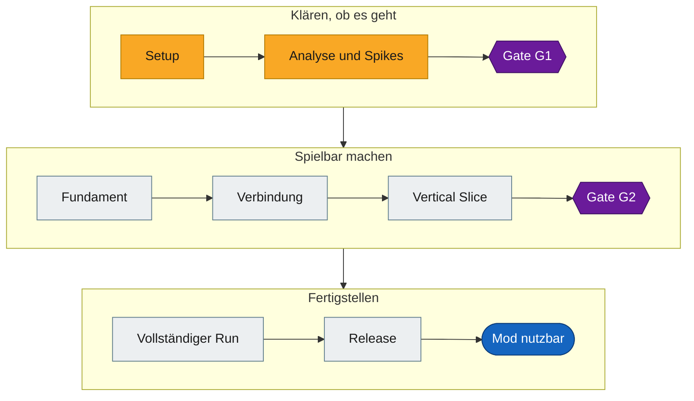

# Deadly Days: Roadtrip – Online Multiplayer Mod

Fan-Mod, die echtes Online-Coop für **Deadly Days: Roadtrip** ermöglichen soll. Das Spiel selbst bietet nur lokales
Couch-Coop, online also nur über Steam Remote Play, bei dem der Host das Bild streamt. Mit der Mod läuft das Spiel bei
jedem Spieler selbst.

**Status:** Phase 1 – Analyse. Es gibt noch keine Mod, aber einen funktionierenden Spike: Zwei Instanzen spielen dieselbe Mission,
der Client erreicht Tag 2, die Reise auf Tag 3 endet noch mit einem Host-Absturz. Ob das Vorhaben aufgeht, entscheidet sich an Gate G1 in [TODO.md](TODO.md).



Was im Einzelnen noch offen ist, zeigt die [Roadmap als Graph](docs/ROADMAP.md).

| | |
|---|---|
| Spiel | Deadly Days: Roadtrip (Steam-AppID `3026450`) |
| Engine | Unreal Engine 5.8, interner Projektname `DDSurvivors` |
| Zielbild | 2 Spieler online, Host-autoritativ, jeder mit eigener Spielkopie |
| Technik | Native C++-DLL (Dumper-7-SDK + Hooks), siehe [Architektur](docs/ARCHITECTURE.md) |

## Fortschritt

Stand: 03.11.2026.

Gezählt sind die Punkte aus [TODO.md](TODO.md), ohne optionale Optimierungen.

| Phase | Ziel | Erledigt | Fortschritt |
|---|---|---|---|
| [0](TODO.md#phase-0--projekt-setup) | Gleiche Toolchain für alle | 9 von 11 | █████████░░ |
| [1](TODO.md#phase-1--analyse-und-spikes) | Fakten für Gate G1 | 26 von 35 | ████████░░░ |
| [2](TODO.md#phase-2--fundament) | Stabile Basis der Mod | 6 von 8 | ████████░░░ |
| [3](TODO.md#phase-3--session-und-verbindung) | Verbinden über Steam | 0 von 6 | ░░░░░░░░░░░ |
| [4](TODO.md#phase-4--vertical-slice) | Spielbarer Ausschnitt | 0 von 9 | ░░░░░░░░░░░ |
| [5](TODO.md#phase-5--vollständiger-run) | Kompletter Run zu zweit | 0 von 10 | ░░░░░░░░░░░ |
| [6](TODO.md#phase-6--release) | Veröffentlichung | 0 von 6 | ░░░░░░░░░░░ |
| **Gesamt** | | **41 von 85** | █████░░░░░░ |

Unter `src/` stehen Loader, Core und leere Modul-Einstiege, noch ohne Spiellogik. Die Punkte sind unterschiedlich groß, die Zahlen sagen also wenig über die verbleibende Zeit. Stand, Engpässe und nächste Schritte stehen in der [Roadmap](docs/ROADMAP.md#stand-und-nächste-schritte).

## Wo finde ich was?

| Dokument | Inhalt |
|---|---|
| [TODO.md](TODO.md) | Roadmap, Phasen, Gates und offene Aufgaben |
| [docs/ROADMAP.md](docs/ROADMAP.md) | Graph: Was bis zur fertigen Mod noch offen ist |
| [docs/GAME_ANALYSIS.md](docs/GAME_ANALYSIS.md) | Was wir über das Spiel wissen, mit Belegen und Vertrauensgrad |
| [docs/ARCHITECTURE.md](docs/ARCHITECTURE.md) | Technische Optionen, Entscheidungen, Modulgrenzen |
| [docs/OFFSETS.md](docs/OFFSETS.md) | Offsets und Funktionsadressen des unterstützten Builds |
| [docs/SETUP.md](docs/SETUP.md) | Entwicklungsumgebung einrichten |
| [docs/TESTING.md](docs/TESTING.md) | Zwei Instanzen starten, Abstürze auswerten, Ergebnisse festhalten |
| [research/spikes/a-connect/](research/spikes/a-connect/README.md) | Stand des Spikes, Patches, gescheiterte Ansätze |
| [CONTRIBUTING.md](CONTRIBUTING.md) | Zusammenarbeit: Branches, PRs, Regeln für das Repo |
| [CLAUDE.md](CLAUDE.md) | Arbeitsregeln für KI-Agenten, auch über [AGENTS.md](AGENTS.md) erreichbar |

## Projektstruktur

```text
.
├─ README.md               Einstieg
├─ TODO.md                 Roadmap und Aufgaben
├─ CONTRIBUTING.md         Regeln für die Zusammenarbeit
├─ .github/                PR- und Issue-Vorlagen
├─ config/                 Vorlage für lokale Pfade (Local.props bleibt lokal)
├─ docs/                   Analyse, Architektur, Setup
├─ research/               Eigene RE-Notizen, Hook-Listen, Spike-Ergebnisse
├─ src/
│  ├─ Loader/              Proxy-DLL, lädt die Mod ins Spiel
│  ├─ Core/                Logging, Config, Hooks, Game-Thread-Dispatcher
│  ├─ Net/                 Transport, Steam-Lobby, Session, Handshake
│  ├─ Game/                Adapter auf Spielklassen (einziger Ort mit SDK-Zugriff)
│  ├─ Sync/                Spiellogik-Synchronisierung
│  └─ UI/                  Lobby-Overlay, Statusanzeige
├─ tests/                  Tests für Code ohne Spielabhängigkeit
├─ third_party/            Abhängigkeiten (Hinweise, siehe README dort)
└─ tools/                  Skripte (Spike bauen und testen, später Deploy)
```

Jedes Modul unter `src/` hat eine eigene `README.md` mit Aufgabe und Grenzen. So kann das Team parallel arbeiten, ohne
sich gegenseitig in dieselben Dateien zu schreiben (siehe [CONTRIBUTING.md](CONTRIBUTING.md)).

## Für neue Mitwirkende

Die bisherige Analyse muss niemand wiederholen. Ergebnisse, Offsets, Patches und Testskripte liegen im Repo.

1. Spiel in Steam installieren und auf die [unterstützte Version](docs/GAME_ANALYSIS.md#unterstützte-spielversion) bringen.
2. [docs/SETUP.md](docs/SETUP.md) durcharbeiten: einrichten, mit `tools/Test-Setup.ps1` prüfen, Solution bauen, Tests ausführen.
3. Eine Testsitzung nach [docs/TESTING.md](docs/TESTING.md) starten, dann läuft der aktuelle Stand bei dir.
4. [CONTRIBUTING.md](CONTRIBUTING.md) lesen und eine Aufgabe aus [Wo kann ich anfangen?](TODO.md#wo-kann-ich-anfangen) nehmen.

## Rechtliches

Dies ist ein inoffizielles Fan-Projekt ohne Verbindung zu Pixelsplit oder dem Publisher. Jeder Spieler braucht eine
eigene Kopie des Spiels. Der Code dieses Projekts steht unter der [MIT-Lizenz](LICENSE), das gilt nicht für das Spiel selbst.
Spieldateien, entpackte Assets und generierte SDKs gehören **nicht** ins Repo
(siehe [CONTRIBUTING.md](CONTRIBUTING.md#was-nie-ins-repo-darf)).
