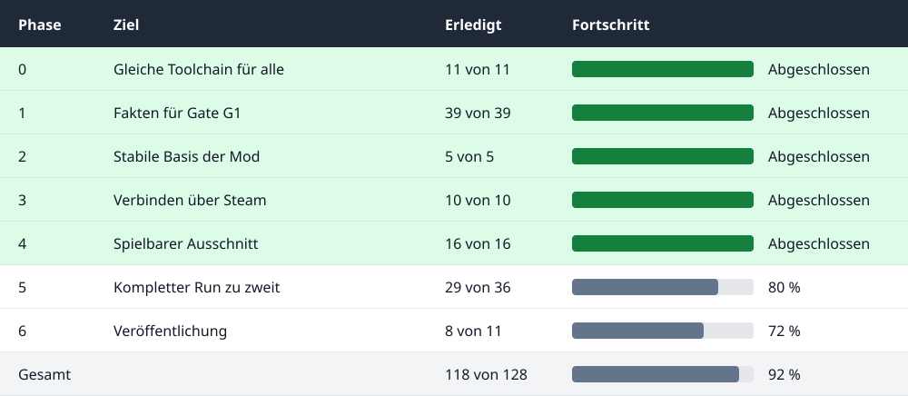

# Deadly Days: Roadtrip – Online Multiplayer Mod

Fan mod that adds real online co-op to **Deadly Days: Roadtrip**. The game itself only offers local couch co-op, so playing
online currently means Steam Remote Play, where the host streams the picture. With this mod every player runs the game on
their own PC.

**Status (8 Nov 2026):** Experimental, no public download yet. **Gate G2 passed on 7 Nov 2026:** Two PCs in separate households played the same mission through a Steam lobby for at least ten minutes on game build `26495302`, without crashes or persistent desync ([test report](docs/GAME_ANALYSIS.md#gate-g2-auf-zwei-pcs-am-07112026-integration-g2)). Movement, combat, airdrops and round transitions work in documented partial tests. **A complete run is not yet verified**; in particular progression, the day cycle, client inventory divergence and run completion remain open (see [Phase 5](TODO.md#phase-5--vollständiger-run)).

**Contributing:** Anyone can help, no invitation needed: C++, reverse engineering, testing with two players, or docs.
Start with [For new contributors](#for-new-contributors), free tasks are listed under [Where can I start?](TODO.md#wo-kann-ich-anfangen). Docs and the task list are written in German, but issues and pull requests in English are welcome. Fork the repo and open a pull request; for bigger changes please open an issue first.

The [roadmap graph](docs/ROADMAP.md) shows what is still open.

| | |
|---|---|
| Game | Deadly Days: Roadtrip (Steam AppID `3026450`) |
| Engine | Unreal Engine 5.8, internal project name `DDSurvivors` |
| Target | 2 players online, host-authoritative, each with their own game copy |
| Tech | Native C++ DLL (Dumper-7 SDK + hooks), see [architecture](docs/ARCHITECTURE.md) |

## Progress

As of 08 Nov 2026.

Tasks are counted per phase from [TODO.md](TODO.md), excluding maintenance, optional optimizations and Real Coop logic.

Done means listed under "Erledigt" in `TODO.md`. **Fully completed phases are highlighted green.** `py tools/task_status.py update` refreshes the graphic and the text table; `py tools/task_status.py check` and CI prevent mismatches. Claims and PRs do not change completion status.



<details>
<summary>Progress as text table with links to the phases</summary>


| Phase | Goal | Done | Progress |
|---|---|---|---|
| [0](TODO.md#phase-0--projekt-setup) | Same toolchain for everyone | 11 of 11 | ███████████ |
| [1](TODO.md#phase-1--analyse-und-spikes) | Facts for gate G1 | 39 of 39 | ███████████ |
| [2](TODO.md#phase-2--fundament) | Stable mod foundation | 5 of 5 | ███████████ |
| [3](TODO.md#phase-3--session-und-verbindung) | Connecting via Steam | 10 of 10 | ███████████ |
| [4](TODO.md#phase-4--vertical-slice) | Playable slice | 16 of 16 | ███████████ |
| [5](TODO.md#phase-5--vollständiger-run) | Complete run for two | 38 of 41 | ██████████░ |
| [6](TODO.md#phase-6--release) | Release | 9 of 10 | ██████████░ |
| **Total** | | **128 of 132** | ███████████ |

</details>

`src/` holds the loader, core, the Steam network layer, an in-game tested [mod overlay](src/UI/README.md) and the
[game adapter layer](src/Game/README.md) with the co-op patches. Tasks differ in size, so the numbers say little about the remaining time. Status, bottlenecks and next steps are in the [roadmap](docs/ROADMAP.md#stand-und-nächste-schritte).

## Install (players)

No public release yet. Once there is one, the package `DDCoop-<version>.zip` is installed by extracting it and double-clicking `Install.cmd`; see the [installation guide](docs/INSTALL.md) (requirements, uninstall, error messages, antivirus notes).

## Where to find what

| Document | Content |
|---|---|
| [TODO.md](TODO.md) | Roadmap, phases, gates and open tasks |
| [docs/ROADMAP.md](docs/ROADMAP.md) | Graph: what is still open until the mod is finished |
| [docs/GAME_ANALYSIS.md](docs/GAME_ANALYSIS.md) | What we know about the game, with evidence and confidence |
| [docs/ARCHITECTURE.md](docs/ARCHITECTURE.md) | Technical options, decisions, module boundaries |
| [docs/OFFSETS.md](docs/OFFSETS.md) | Offsets and function addresses of the supported build |
| [docs/SETUP.md](docs/SETUP.md) | Setting up the development environment |
| [docs/TESTING.md](docs/TESTING.md) | Starting two instances, analyzing crashes, recording results |
| [research/spikes/a-connect/](research/spikes/a-connect/README.md) | Spike status, patches, failed approaches |
| [CONTRIBUTING.md](CONTRIBUTING.md) | Collaboration: branches, PRs, repo rules |
| [CLAUDE.md](CLAUDE.md) | Working rules for AI agents, also reachable via [AGENTS.md](AGENTS.md) |

## Project structure

```text
.
├─ README.md               Entry point
├─ TODO.md                 Roadmap and tasks
├─ CONTRIBUTING.md         Collaboration rules
├─ .github/                PR and issue templates
├─ config/                 Template for local paths (Local.props stays local)
├─ docs/                   Analysis, architecture, setup
├─ research/               Own RE notes, hook lists, spike results
├─ src/
│  ├─ Loader/              Proxy DLL, loads the mod into the game
│  ├─ Core/                Logging, config, hooks, game-thread dispatcher
│  ├─ Net/                 Transport, Steam lobby, session, handshake
│  ├─ Game/                Adapter to game classes (only place with SDK access)
│  ├─ Sync/                Game logic synchronization
│  └─ UI/                  Lobby overlay, status display
├─ tests/                  Tests for code without game dependency
├─ third_party/            Dependencies (notes, see README there)
└─ tools/                  Scripts (build and test the spike, later deploy)
```

Each module under `src/` has its own `README.md` with its purpose and limits, so the team can work in parallel without
writing into the same files (see [CONTRIBUTING.md](CONTRIBUTING.md)).

## For new contributors

Nobody has to repeat the analysis so far. Results, offsets, patches and test scripts are in the repo.

1. Install the game in Steam and bring it to the [supported version](docs/GAME_ANALYSIS.md#unterstützte-spielversion).
2. Work through [docs/SETUP.md](docs/SETUP.md): set up, check with `tools/Test-Setup.ps1`, build the solution, run the tests.
3. Start a test session as described in [docs/TESTING.md](docs/TESTING.md); then the current state runs on your machine.
4. Read [CONTRIBUTING.md](CONTRIBUTING.md) and pick a task from [Where can I start?](TODO.md#wo-kann-ich-anfangen).

## Legal

Unofficial fan project, not affiliated with Pixelsplit or the publisher. Every player needs their own copy of the
game. The code is under the [MIT License](LICENSE), which does not cover the game itself.
Game files, extracted assets and generated SDKs are **not** part of this repo
(see [CONTRIBUTING.md](CONTRIBUTING.md#was-nie-ins-repo-darf)).
