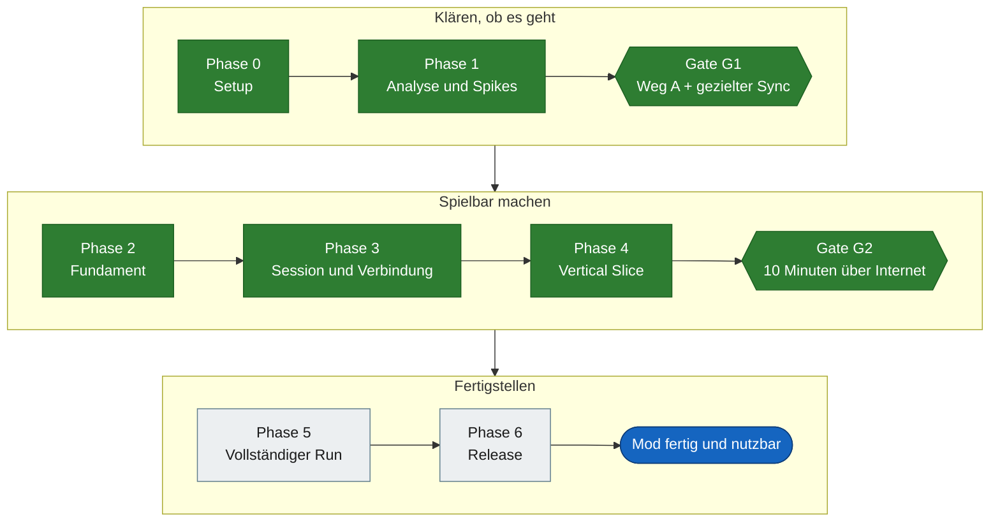
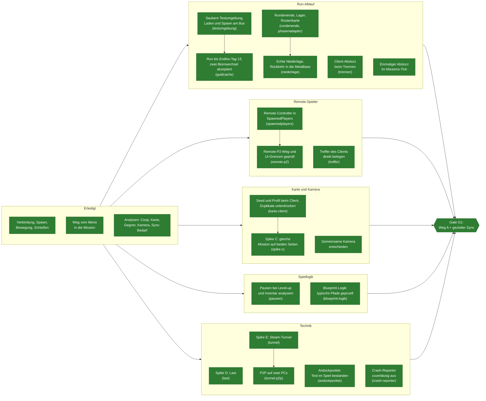
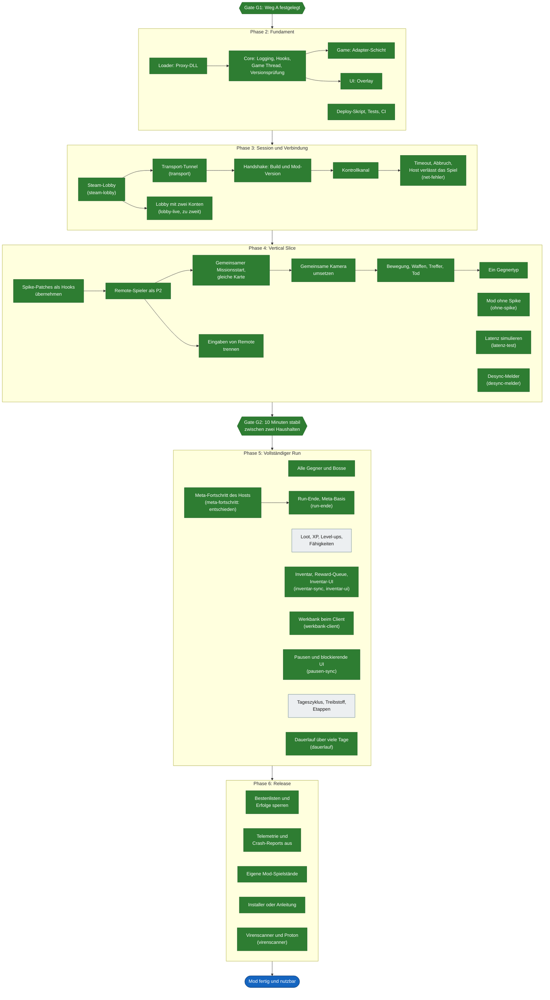
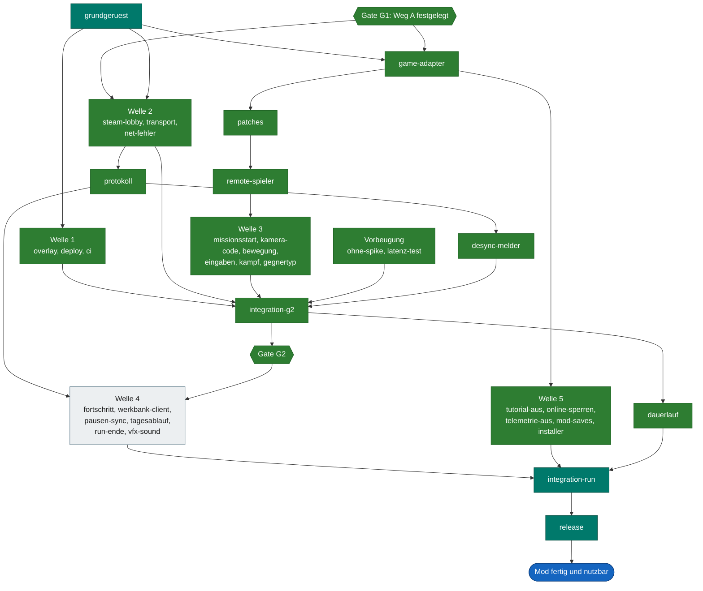

# Roadmap als Graph

Diese Seite zeigt, was bis zur fertigen und nutzbaren Mod noch offen ist. Führend bleibt [TODO.md](../TODO.md), hier steht nur die Übersicht.

**Fertig und nutzbar** heißt: Zwei Spieler finden sich über Steam, spielen einen kompletten Run online, und die Mod lässt sich installieren, ohne Spielstände oder Bestenlisten zu berühren. Dafür müssen alle Punkte mit P0 und P1 erledigt sein. P2 und [Optionale Optimierungen](../TODO.md#optionale-optimierungen) kommen danach.

Den Fortschritt je Phase zeigt das [README](../README.md#fortschritt).

## Stand und nächste Schritte

Projektstand vom **08.11.2026**; die aktuellen Aufgaben, Abhängigkeiten und Abnahmen stehen verbindlich in [TODO.md](../TODO.md).

**Was läuft.** Die Mod verbindet zwei eigene Spielinstanzen per Steam-Lobby über das Internet, synchronisiert Missionsstart, gemeinsame Karte, Bewegung, Kampf und wesentliche Inventar-/Rundenabläufe. **Gate G2 ist bestanden**: Am 07.11.2026 liefen zwei PCs aus unterschiedlichen Haushalten auf Build `26495302` mindestens zehn Minuten in derselben Mission ohne Absturz und dauerhaften Desync ([Messung](GAME_ANALYSIS.md#gate-g2-auf-zwei-pcs-am-07112026-integration-g2)). Die Phasen 0–4 sind abgeschlossen. Beide Game-Builds `26187885` und `26495302` sind derzeit in der Installation berücksichtigt; der Umstieg auf nur den neuen Build steht noch aus.

**Was fehlt.** Ein **vollständiger gemeinsamer Run** vom Start bis zum Endboss ist noch nicht bestanden. Offen sind unter anderem die Zwei-PC-Bestätigung von `fortschritt` und `integration-run`. Der Code von `lager-handel-client` ist integriert, seine vorgeschriebene Zwei-PC-Bestätigung ist jedoch noch offen. Vor einem Release müssen außerdem Virenscanner-/Proton-Dokumentation und die abschließende Integration geprüft werden ([Aufgabenliste](../TODO.md#wo-kann-ich-anfangen)).

**Prüfgrenze.** Dies ist eine Dokumentationskorrektur auf Grundlage der vorhandenen Spieltestprotokolle und TODO-Einträge, **kein neuer Spieltest**. Der G2-Nachweis gilt ausdrücklich nicht als Nachweis eines vollständigen Runs.

**Bisherige Befunde (datierte Momentaufnahmen, teilweise inzwischen überholt):**

- `opt-gegner-indikatoren`, 11.11.2026: Der Client sieht die Warnanzeigen der Gegner (Kreis beim Spucken, Springen und bei Bossen, Strich vor dem Sprint). Die Angriffsfähigkeiten laufen nur beim Host, ihre Niagara-Anzeigen replizieren nicht. Der Host meldet je Anzeige nur den Auslöser (`0x900`, Mod-Version 11), der Client zeigt sie mit dem nativen System bzw. der eigenen Komponente des Gegners. Spieltest auf einem PC: Host 63 Kreise / 17 Striche, Client 63 / 17, auch nach einem Kartenwechsel; in zwei weiteren Läufen fehlte je ein Kreis von rund 50 (Ursache offen).

- `run-ende`, 10.11.2026: Der Client sieht das Run-Ende jetzt selbst. Bei einer Niederlage meldete der Host bisher nichts, der Client stand in der eingefrorenen Mission. Der Host überträgt nun den Ausgang im Rundenende (`0x401`, Mod-Version 10), der Client öffnet seine native Übersicht und schaltet sie auf „Du bist gestorben!“ oder „Du hast gewonnen!“ um. Rückkehr und Reise wählt weiter nur der Host. Eine Niederlage löst der Client nie selbst aus, sie hätte seinen Meta-Stand geändert. Im Spiel geprüft (`26495302`, ein PC): Niederlage, neuer Run in derselben Sitzung mit Rundenende, Lager und Reise, Sieg, Abbruch über das Pausemenü, normale Spielstände Byte für Byte gleich, Meta-Stand des Clients unverändert. Nicht geprüft: zwei PCs, ausgespielter Endboss. [Befund](GAME_ANALYSIS.md#run-ende-bei-host-und-client-run-ende)
- `tagesablauf`, 10.11.2026: Tag, Uhr, Tank, Nacht und Missionsziele replizieren nativ, die Mod braucht dafür keinen eigenen Sync. Neu ist eine Messung: Die Testkanal-Anfrage `day` liest per Reflexion alle Felder von GameState, Tank, Nacht, Gefahrenstufe und `DDObjective`, `day_state.py` und `Run-Route.ps1 -DayState` vergleichen beide Seiten. Belegt an Tag 1 über 300 s mit Kanister; der Lauf über mehrere Tage wurde nach Tag 1 beendet, der Nutzer hat den Test als erfolgreich abgenommen. [Befund](GAME_ANALYSIS.md#tagesablauf-tag-uhr-tank-nacht-und-ziele-tagesablauf)

- `spiel-update`, 09.11.2026: Umstieg auf Build `26495302` abgeschlossen. Alle RVAs in `src/` und im Spike sind jetzt Werte von `26495302` (Referenz-Build), die Umrechnungstabelle und alle Verzweigungen für `26187885` sind entfernt; Mod, Skripte, Installer und Hash-Referenz kennen nur noch `26495302`. Offline 74 Byte-Prüfungen und 89 Signaturen `ok`. Im Spiel (ein PC, Mod und Spike, Lobby): 44 Patches bei Host und Client, `Run-Route.ps1 -Days 2` sauber. [Offsets](OFFSETS.md#referenz-build-26495302-spiel-update)
- `opt-dev-tab`, 09.11.2026: Entwicklerwerkzeug im Overlay-Tab „Dev“ mit fünf Knöpfen: Spawn XP, Full Tank, Godmode, Spawn Zombies am Cursor und Spawn Random Item. Solo führt die eigene Instanz aus, im Koop fragt der Client über `0x600` beim Host an. Spieltest mit Host und Client an Tag 1 bestanden. Vor dem Release entfernen.
- `lager-handel-client`, 07.11.2026: Der Client verkauft und repariert im Lager. Vorher buchte das native Panel den Schrott nur lokal, und der Schrott repliziert nicht: Der Host entfernte verkaufte Items ohne Gutschrift, Reparaturen scheiterten am Schrott des Clients. Jetzt beginnt der erste Verkauf oder die erste Reparatur eine lokale Bearbeitung, der Edit meldet beides, der Host prüft jede Aktion, führt sie nativ aus und bucht den Schrott einmal. Der Host schickt seinen Schrott an den Client (`0x309`, Mod-Version 9). Kaputte Items sperrt das Spiel auch beim Host am Ablegen. Im Spiel geprüft (`26495302`, ein PC): Verkauf und Reparatur übernommen, Schrott und Inventare gleich, Ablehnung stellt den Client wieder her. [Ablauf](../src/Game/README.md#verkaufen-und-reparieren-beim-client)
- `pausen-sync`, 08.11.2026: Das Pausemenü des Clients pausierte nur ihn, der Host lief weiter. Jetzt meldet der Client über `0x700`, ob sein Pausemenü offen ist; der Host hält dann eine Zeitanfrage mit den Werten seines eigenen Pausemenüs, die Weltpause repliziert nativ. Freigabe beim Schließen, nach 3 s ohne Meldung, bei Weltwechsel und Trennung. Airdrop, Lager, Reise, Level-up und Dialoge brauchen nichts Neues. Mod-Version 9. Im Spiel auf `26495302` belegt: Pause und Weiter in beide Richtungen mit gleicher Weltzeit, Inventaransicht im Pausemenü, Absturz des Clients bei offenem Menü gibt nach 3 s frei, Gegenproben Airdrop, Lager und Reise zu Tag 2. [Befund](../research/spikes/pausen/README.md#umsetzung-pausen-sync-08112026)
- `patch-signaturen`, 07.11.2026: Tabelle `src/Game/PatchSignatures.inc` mit Byte-Mustern für alle 88 Code-Adressen der Patches, erzeugt und geprüft von `tools/patch_signatures.py`. Die Mod prüft alle Muster beim Start vor dem ersten Hook; passt eines nicht, liefert `Memory::Rva` 0, und nur die Patches, die die Adresse in `Patch::Sites` nennen, fallen mit Logmeldung aus, der Tick ihrer Liste ebenfalls. `sites --write` leitet die Sites aller 43 Patches aus Check, Apply und Hooks ab. Im Spiel auf `26495302` mit absichtlich falschem OpenCrate-Muster: 1 von 88 Adressen gesperrt, nur „Airdrop-Oeffnung nur beim Host“ ausgelassen, 42 Patches gesetzt, Lobby mit zwei Spielern. [Werkzeug](../tools/README.md#patch_signaturespy)
- `tod-client`, 07.11.2026: Ein toter Client lief mit vollem Tempo weiter, und der Host übernahm seine Position. Ursache: Beim Tod setzt der Host das replizierte Tempo-Attribut auf Kriechtempo, `MaxWalkSpeed` folgt ihm nativ aber nur beim Host; die Vorhersage des Clients führte außerdem Dodges aus, die der Host ablehnt. Jetzt übernimmt der Client das Tempo aus dem Attribut und dodgt bei HP 0 nicht, ohne neue Nachricht. Im Spiel auf `26495302` belegt: Kriechen bei beiden Seiten, kein Dodge und kein Einsammeln im Tod, Wiederbelebung, Niederlage und Rundenende wie gehabt. Nebenbefund: Der Client stürzt ab, wenn der Sensenmann erscheint, siehe [Tod des Clients](GAME_ANALYSIS.md#tod-des-clients-tod-client).
- `doku-verweise`, 07.11.2026: `task_status.py check` meldet jetzt Sätze in versionierten Markdown-Dateien, die eine schon erledigte Kennung noch ankündigen („kommt mit `x`“, „folgt erst in `x`“, „bis `x`“), mit Datei und Zeile; die CI führt das aus. Korrigiert: Net-README (`steam-lobby`), OFFSETS und Roadmap (`update-client`), Overlay-Absatz in Testen. Neu in Testen: Weg mit der Mod über die Lobby auf zwei PCs. [Werkzeug](../tools/README.md#task_statuspy)
- `lobby-live-rest`, 07.11.2026: Start über `+connect_lobby` und geordnetes Verlassen mit zwei Konten bestätigt. Bei geschlossenem Spiel startete Steam es nach der angenommenen Einladung, die Mod trat sofort bei, 3 s später stand der Client ohne Klick in der MetaBase des Hosts. Nach „Verlassen“ meldete der Host zweimal Grund 1002, 1 Spieler und offene Lobby, ohne Absturz. Damit hat Phase 3 keine offenen Aufgaben mehr. [Lobby-Abnahme](GAME_ANALYSIS.md#lobby-abnahme-auf-zwei-pcs-am-07112026-lobby-auth-live-lobby-live-rest)
- `lobby-auth-live`, 07.11.2026: Zugriffskontrolle mit zwei Konten auf zwei PCs über das Internet bestätigt. Der eingeladene Freund verbindet, ein Konto außerhalb der Lobby bekommt nach 5 s Wartezeit 1005 („nicht Mitglied seiner Lobby“) und keinen Platz, nach dem Verlassen des Clients steht der Host wieder bei 1 Spieler mit offener Lobby. Neu dafür: `Start-Session.ps1 -SteamLaunch` (Steam startet das Spiel nach einer Einladung) und `-Tunnel Mod -NoSpike` für den Client. [Lobby-Abnahme](GAME_ANALYSIS.md#lobby-abnahme-auf-zwei-pcs-am-07112026-lobby-auth-live-lobby-live-rest)
- `opt-ladezeit-messung`, 07.11.2026: `check_round.py --wait` meldete keine Ladezeit, weil es eine ladende Instanz (World 0) für beendet hielt. Jetzt zählt nur ein beendeter Prozess als Abbruch, gemessen wird bis zur neuen World mit allen Spielern im GameState, und `Run-Route.ps1` startet die Messung vor dem Klick. Auf `26495302` ohne Spike: 1,0 s bis Tag 1.
- `sdk-vergleich`, 07.11.2026: `tools/sdk_diff.py` vergleicht zwei lokale Dumper-7-SDKs für alles, was die Mod nutzt (Felder aus `SdkChecks.cpp`, per Name gerufene Funktionen, `FieldSpec`, Klassennamen und `Klasse.Feld`-Verweise in `src/` und `docs/OFFSETS.md`). Probelauf mit zwei SDKs desselben Builds: 199 Einträge, alle unverändert. Ergänzt `rva_map.py` beim nächsten Spiel-Update.
- `livetest-0711`, 07.11.2026: Live-Test auf zwei PCs mit Build `26495302`, nur Mod. Alle Patch-Listen gesetzt, drei Rundenenden und beide Abbruchtests im Lager ohne Absturz, Client-Dodge ohne Rutschen. Bestanden: `update-client`, `update-inventar`, `dodge-client-live`, `lager-absturz-client`, `airdrop-dodge-absturz` (nach Nutzerentscheidung mit 5 statt 10 Airdrop-Dodges). Neu: `lager-handel-client`, Verkaufen und Reparieren im Lager fehlen beim Client. [Bericht](GAME_ANALYSIS.md#live-test-auf-zwei-pcs-am-07112026-livetest-0711)
- `update-basis`, 07.11.2026: Umstieg auf Steam-Build `26495302` vorbereitet, beide Builds laufen parallel. Eingefrorene Kopie und Hash-Referenz je Build, die Mod erkennt den Build am Exe-Header, der Handshake vergleicht ihn. Die RVAs im Quelltext bleiben die von `26187885`; `Game::AddressMap` rechnet sie über eine von `tools/rva_map.py` erzeugte Tabelle um (88 von 97 automatisch, 9 fehlen wegen geändertem Spielcode). Neues SDK: Kernadressen bestätigt, alle Feld-Offsets unverändert. Auf `26187885` weiter 43 Patches, auf `26495302` setzt die Mod ohne vollständige Portierung keine, mit `-PartialPatches` 8 von 13 Listen. Den Lobby-Beitritt ohne Absturz hat danach `update-client` geliefert. [Befund](OFFSETS.md#build-26495302-update-basis)
- `spike-build-26495302`, 07.11.2026: Der Spike läuft auch auf Build `26495302`. `Rva()` in `Builds.cpp` rechnet seine Adressen über die Tabelle der Mod plus vier eigene Einträge um, relative Sprünge prüft `ExpectBranch` auf ihr Ziel, Importeinträge werden in der Importtabelle gesucht. Die Sperre in `Start-Session.ps1` ist weg. Ein PC, zwei Instanzen: Spike allein und mit `-Mod -Tunnel Lobby` bis `DDDynamic_Map`, alle Spike-Patches gesetzt, `!wave` wirkt, kein Absturz; `26187885` nicht erneut gestartet, dort bleibt `Rva()` die Identität. [Befund](OFFSETS.md#spike-spike-build-26495302)
- `update-inventar`, 07.11.2026 (Bestätigungstest bestanden, siehe `livetest-0711`): Inventar-, Belohnungs-, Airdrop-, Widget- und Lebensleisten-Patches auf `26495302` portiert. Sieben Adressen von Hand über Exec-Thunks und Konstruktor-Verweise, Byte-Prüfungen je Build, Aufrufziel statt rel32 beim Detektor-Timer, `InventoryPanel.IsDragging` je Build (`0x790`/`0x788`). Mit `-PartialPatches` 11 von 13 Listen, offen nur Player und Client. Laut Patchnotes 1.0.1 wird kein Patch überflüssig. Client-Abnahme (Airdrop, Belohnungswahl, Lager) nach `update-client`. [Befund](OFFSETS.md#inventar-belohnung-lebensleisten-update-inventar)
- `waffe-client-auswahl`, 07.11.2026: Waffen aus der Itemauswahl des Clients wirken sofort. Drei Ursachen behoben: Der Host nahm Items beim Übernehmen mit vertauschtem Entfernstil aus dem Rucksack, frischte danach die Itemwirkungen nicht auf (neue Waffe erst nach Levelaufstieg aktiv), und der Client rechnete belegte Waffenslots während der Bearbeitung nie nach. Jetzt frischt der Host beide Figuren mit `RefreshItemEffects` auf, der Client zeigt die Waffenslots lokal vor, der Host bleibt verbindlich. Auf einem PC geprüft: Ausgerüstete Waffen beim Host gleich dem Rucksack des Clients. [Befund](../src/Game/README.md#waffen-aus-der-itemauswahl-des-clients-waffe-client-auswahl)
- `mod-saves`, 07.11.2026: Mit geladener Mod speichert das Spiel nur noch in `Saved\SaveGames_DDCoop`, bei Host, Client und allein. Die Mod leitet dafür die Datei-APIs von Windows um, ohne Spiel-Offsets, weil der SaveManager Sicherungen, Zwischendateien und Archivkopien selbst anlegt. Beim ersten Start kopiert sie die normalen `.sav` einmal hinüber (`copy_normal_saves`). Fehlt eine Umleitung, startet die Mod nicht. Im Spiel belegt: Das Rundenende beim Client mit Lager und Reise schreibt nur in den Mod-Ordner, die normalen Stände beider Instanzen bleiben Byte für Byte gleich, ein zweiter Start lädt die Mod-Stände, ohne Mod schreibt das Spiel wie im Original. Nebenbei ist der alte Build per `download_depot` wieder hergestellt und auf diesem PC eingefroren. [Befund](GAME_ANALYSIS.md#spielstände-der-mod-mod-saves)
- `reflexion-felder`, 07.11.2026: Neuer Helfer `Game::Reflection` löst Felder (`FProperty` über `ChildProperties`: Offset, Größe, Typ) und Funktionen (`UFunction` über `Children`) von Spielklassen zur Laufzeit auf, einmal je Start gecacht, mit festen Schleifengrenzen und geschützten Lesezugriffen. Passt ein Feld nicht (Name, Typ, Größe, Bitfeld-`bool`, Grenze), bleibt nur der betroffene Adapter mit einer Logmeldung aus. `TutorialAdapter` und `TelemetryAdapter` sind umgestellt, ihre festen Offsets entfallen; die Engine-Grundlayouts stehen in `Offsets.h` und werden gegen das SDK geprüft. Im Spiel stimmen alle fünf Laufzeitwerte mit dem SDK überein, mit Spike zwei Tage mit Lager und Airdrop sauber, ohne Spike Tag 1 und Tutorial-Abschaltung über die gefundene Funktion bei Host und Client. Neue Feldzugriffe laufen über den Helfer, siehe [Game](../src/Game/README.md#muster-für-neue-adapter).
- `lobby-live`, 06.11.2026: Die Steam-Lobby funktioniert mit zwei Konten über das Internet. Aus den Logs der beiden Live-Sitzungen: Einladung über Steam angenommen, P2P über das Steam-Relay, Handshake des Kontrollkanals bestätigt und MetaBase mit zwei Spielern in 1,6 s; verlässt der Host, landet der Client sauber im Hauptmenü. Ungeprüft waren der Start über `+connect_lobby` und das Verlassen des Clients, nachgeholt in `lobby-live-rest`. Damit ist `integration-g2` nicht mehr blockiert, bestanden ist G2 aber nicht: Beide Sitzungen endeten mit Absturz und Inventar-Abweichung des Clients. [Befund](GAME_ANALYSIS.md#steam-lobby-über-das-internet-lobby-live)
- `bestaetigungstests`, 06.11.2026: Expliziter Wartezustand fuer Bestaetigungstests, getrennt von aktiver Entwicklung. `tasks.py tests plan` buendelt Abnahmen, `update`/`pass` bearbeiten mehrere Teststaende bzw. belegte Ergebnisse; aktive fremde Aufgaben werden ausgeschlossen. Wartende Tests bleiben offen und blockieren ihre Abhaengigkeiten. `dodge-client-live` wartet nach dem Diagnose-PR #141 auf die Zwei-PC-Pruefung, nicht als behobener Fehler markiert. [Ablauf](../tools/README.md#bestätigungstests)
- `dodge-client-live`, 07.11.2026, Teilstand: Ursache belegt: Die Richtung, die der Host aus der Ortsänderung schätzte, wich vom echten Client-Dodge ab (Host bucht keine Kosten, oder er bucht sie bei einem abgebrochenen Dodge). Jetzt meldet der Client je Dodge Richtung und Vorhersageschlüssel (`0x500`), der Host übernimmt sie; abgebrochene Dodges werden nach Schubdauer zurückgesetzt. Ein PC mit Internet-Profil: 10 von 10 Dodges mit Richtung, kein Rutschen. Offen: zwei PCs. [Befund](GAME_ANALYSIS.md#dodge-im-zwei-pc-test-dodge-client-live)
- `meta-fortschritt`, 06.11.2026: Vom Nutzer entschieden: Im gemeinsamen Run gilt der Meta-Fortschritt des Hosts fuer beide Spieler. Der Client nutzt ihn nur fuer die Sitzung, ohne dauerhafte Meta-Gutschrift oder Uebernahme ins persoenliche Profil. Umsetzung und Speichertrennung bleiben `fortschritt`, `run-ende` und `mod-saves`; keine neue Laufzeitfunktion behauptet. [Regel](SYNC_REQUIREMENTS.md#nutzervorgabe-meta-fortschritt-des-hosts-06112026)
- `werkbank-client`, 06.11.2026: Der Client wertet Items im nativen Panel auf, per Ablegen auf ein gleiches Item und an der Werkbank. Vorher ging das beim Client nie, weil die Seltenheit der Items nicht repliziert; jetzt schickt der Host sie für das Clientinventar (`0x308`). Die Aufwertung läuft beim Client lokal, der Edit meldet sie, der Host prüft sie gegen die Regel fürs Ablegen oder ein Rezept aus `DT_RecipeTable` und ruft `UpgradeItems` selbst auf. Im Lager beginnt die erste Aufwertung eine lokale Bearbeitung bis zum Bestätigen. Mod-Version 7. Im Lager an Tag 1 und 2 geprüft (Ablegen, Werkbank, beides in einem Edit), nach der Reise Inventare gleich; Airdrop und Lager ohne Aufwertung wie bisher. [Befund](../src/Game/README.md#werkbank-und-aufwerten-beim-client)
- `livetest-befunde`, 06.11.2026: Erster Live-Test auf zwei PCs über das Internet bis Tag 2, abgebrochen durch einen Absturz des Clients im Lager. Beim Client wirkten getauschte Waffen nicht, das Inventar wich dauerhaft ab, Aufwerten fehlt (`werkbank-client`), der Dodge-Fix wirkte laut Nutzer nicht. Neu: `lager-absturz-client`, `waffe-client-auswahl`, `inventar-client-abweichung`, `dodge-client-live`. [Befund](GAME_ANALYSIS.md#live-test-auf-zwei-pcs-am-06112026-livetest-befunde)
- `xp-baelle-live`, 06.11.2026: Im Spiel gegengeprüft, ohne Code-Änderung. Beim Client sind die Sichtgrenzen der XP-Bälle jetzt dieselben wie beim Host (4370/4851 statt vorher 1050/5750). Auch bei weit auseinanderstehenden Figuren lagen die Bälle am linken und am rechten Bildrand auf beiden Seiten gleich. Eingesammelte Bälle verschwanden auf beiden Seiten. Level und XP blieben bis Level 6 gleich, es wurde nichts doppelt gezählt. Gegenproben Bewegung, Dodge, zwei Airdrops und Lager bestanden, kein Absturz. [Befund](GAME_ANALYSIS.md#xp-bälle-beim-client-xp-baelle)
- `skripte-rundenende`, 06.11.2026: `Run-Route.ps1` und `Travel-Day.ps1` bestätigen das Lager am Rundenende jetzt bei Host und Client (`Complete-RoundEnd` in `tools/spike/Common.ps1`) und warten, bis der Host die Routenkarte zeigt. `Run-Route.ps1 -Days 2` lief sauber bis Tag 2 (Exitcode 0, Inventare gleich), `Travel-Day.ps1` bis Tag 3. [Testen](TESTING.md#mission-über-das-spielmenü)
- `charakter-wahl`, 10.11.2026: Jede Seite wählt ihre Figur nativ in der MetaBase. Die Remote-Figur trug bisher auf jeder Seite die eigene Wahl dieser Seite, weil der Applier den Index nur von einem LocalPlayer nimmt. Jetzt geht nur der Name der Definition über den Kontrollkanal (`0x800`), jede Seite wendet ihn auf die Remote-Figur an; der Host bleibt beweglich, wenn die Client-Figur ein MetaBase-POI betritt. Live auf einem PC bestätigt, Rest unter `opt-charakter-takt`. [Befund](GAME_ANALYSIS.md#charakterwahl-in-der-metabase-charakter-wahl)
- `opt-ausdauerbalken`, 10.11.2026: Der Client zeigt den Ausdauerbalken des Hosts wie der Host. Ursache wie bei den Lebensleisten: Das Spiel löst `OnStaminaChanged` nur beim Host aus, beim Client lief nur das OnRep. Die Mod ruft jetzt nach `OnRep_Stamina` und `OnRep_MaxStamina` die angemeldeten Empfänger auf. Live auf einem PC bestätigt. [Befund](GAME_ANALYSIS.md#ausdauerbalken-beim-client-opt-ausdauerbalken)
- `opt-lootbalken`, 11.11.2026: Der Client sieht beim Durchsuchen den Fortschritt wie der Host. Der Wert replizierte schon, nur der Aufruf ins native Widget fehlte, der Client gibt ihn jetzt selbst weiter. Keine neue Nachricht, das Loot vergibt weiter der Host.
- `opt-busbalken`, 10.11.2026: Der Client sieht den Ladebalken der Busabfahrt wie der Host. Der Balken lief nur beim Host, weil Zeit und Fortschritt nicht replizieren und die Abfahrtsprüfung beim Client gesperrt ist. Der Client leitet die Abfahrt jetzt aus vollem Tank und allen Figuren im Busbereich ab und treibt den nativen Balken lokal, ohne neue Nachricht. Live auf einem PC bestätigt (Verlauf im Gleichschritt mit dem Host). [Befund](GAME_ANALYSIS.md#busbalken-beim-client-opt-busbalken)
- `dauerlauf`, 09.11.2026: 12 Tage mit Mod, Latenzprofil Internet und Godmode ohne Absturz, über Endboss und Endlosmodus; Speicher und NetGUID-Cache je Tag ohne stetiges Wachstum, siehe [Dauerlauf](../research/spikes/dauerlauf/README.md).
- `virenscanner`, 09.11.2026: Windows Defender meldet das Release-Paket nicht, Umgang mit Fehlalarmen und Proton (nicht unterstützt) stehen in [Installation](INSTALL.md#virenscanner-und-proton).
- `installer`, 06.11.2026: Release-Paket `dist/DDCoop-<Version>.zip` aus `tools/New-ReleasePackage.ps1` mit `Install.cmd`/`Uninstall.cmd`. Der Installer findet das Spiel in allen Steam-Bibliotheken, prüft Build `26187885` über das Steam-Manifest, laufendes Spiel und fremde `version.dll` und kopiert nur Loader und Mod; `ddcoop.ini`, Logs und Spielstände bleiben. `Deploy-Mod.ps1` nutzt denselben Installer. 11 Tests mit nachgebautem Steam-Ordner, echtes Paket an der Steam-Installation installiert und wieder entfernt, ohne Spielstart. Defender und Proton bleiben `virenscanner`. [Installation für Spieler](INSTALL.md)
- `inventar-sync` und `inventar-ui`, 06.11.2026: Ohne eigene Umsetzung geschlossen, weil andere Aufgaben sie abdecken. Den Weg über den nativen `CoopInventoryCoordinator` hat das Projekt verworfen. Rucksack: `inventar-lokal` und `ausruestung-felder`. Lager: `rundenende-client`. Reward-Queue: `airdrop-warten` und `bestaetigen-alle`. Itemsäcke: `inventar-transaktion`. Der Client bedient sein Inventar im nativen Panel. Die Werkbank (Items aufwerten) ist im Coop nicht getestet und steht jetzt als `werkbank-client`.
- `eingaben`, 06.11.2026: Host und Client steuern nur ihre eigene Figur; Bewegung, Dodge, Zielen und Menütasten wirkten schon ohne Änderung getrennt. Die verbleibende Lücke war der native lokale Koop: Ein lokales Gerät hätte an P2 gebunden werden können, der beim Host der Remote-Spieler ist, und beim Client hätte `SpawnLocalPlayer(1)` einen zweiten lokalen Spieler angelegt. Im Netzwerkspiel lehnt die Mod das jetzt an drei nativen Einstiegen ab, ohne Nachricht und ohne Folgen für den Solo-Koop. Im Spiel per Probe belegt; Gegenproben Bewegung, Dodge, Airdrop und Lager bestanden. [Befund](GAME_ANALYSIS.md#eingaben-getrennt-eingaben)
- `gegnertyp`, 06.11.2026: Spawn und Tod von `BP_StandardEnemy` laufen über die native Replikation synchron, ohne eigenen Code; Tode kommen beim Client im Median sofort an, höchstens 2,9 s später. Die abweichenden Gegnerzähler von `opt-gegnerzahl` sind auf beiden Seiten nur zerstörte Objekte vor der Garbage Collection, Gegner-HP repliziert beim Client nicht. Der Desync-Melder vergleicht die Gegnerzahl jetzt standardmäßig, mit 8 Bestätigungen gegen spät replizierte Spawns; 7 min mit zwei Wellen ohne Alarm und Absturz. Neu: `opt-gegner-spawnverzug`. [Befund](GAME_ANALYSIS.md#ein-gegnertyp-synchron-gegnertyp)
- `ausweichen-client`, 06.11.2026: Der Client weicht so weit aus und bremst so ab wie der Host, Ausdauer wird verbraucht. Ursache: Beim Host stand die Laufrichtung des Client-Controllers immer auf (0, 0), sein Dodge brach vor Kosten und Schub ab, und der Client rollte die Kosten zurück. Die Mod schätzt die Richtung beim Host aus dem replizierten Ort und trägt sie direkt vor dem Start von `GA_Dash` ein, der Host führt den Dodge nativ aus. Ohne eigene Nachricht, mit Netzprofil Internet vom Nutzer abgenommen. Nebenbei bestätigt: Spielertod und Rundenende erst, wenn alle tot sind. Neu: `airdrop-dodge-absturz`. [Befund](GAME_ANALYSIS.md#dodge-des-clients-beim-host-ausweichen-client)
- `bestaetigen-alle`, 06.11.2026: Beim Airdrop schließt Bestätigen das Panel nicht mehr sofort, sondern markiert den Spieler als bereit, der Knopf leuchtet gelb. Erst wenn Host und Client bereit sind, bestätigt der Client nativ, der Host übernimmt den Edit und holt sein Bestätigen nach, das Spiel läuft weiter. Neue Nachricht `0x305`, Mod-Version 5. Zwei Airdrops in beiden Reihenfolgen live geprüft. Neu: `bestaetigen-rundenende` für das Lager am Rundenende. [Befund](../src/Game/README.md#airdrop-auswahl)
- `tank-gemeinsam`, 06.11.2026: Der Tank am GameState ist schon nativ ein Gruppenwert, ohne Code-Änderung. Je ein Kanister von Host und Client zählte einmal und auf beiden Seiten gleich, der volle Tank gab die Busflucht frei, und der Client öffnete danach selbst die Rundenübersicht. [Befund](GAME_ANALYSIS.md#tank-als-gruppenwert-tank-gemeinsam)
- `bestaetigen-rundenende`, 06.11.2026: Im Lager am Rundenende markiert Bestätigen wie beim Airdrop nur bereit (Knopf gelb); der Host kommt erst zur Routenkarte, wenn auch der Client bestätigt hat. In beiden Reihenfolgen über zwei Rundenenden bis Tag 3 geprüft, ebenso Trennen des Clients während der Host wartet. Mod-Version 6. [Befund](../src/Game/README.md#airdrop-auswahl)
- `ci-doku-pruefung`, 06.11.2026: Reine Doku-PRs ließen sich nicht mergen, weil die CI mit `paths-ignore` gar nicht lief und die Pflichtprüfungen `build-and-test` fehlten. Jetzt läuft sie immer und überspringt nur die Build-Schritte. [CI](../tests/README.md#ci)
- `rundenende-client`, 06.11.2026: Beendet der Host die Runde, öffnet der Client Rundenübersicht und Lager selbst (natives `FinishMission` nach einer Meldung über den Kontrollkanal) und ordnet dort sein Inventar. Reisen startet nur der Host. Mit `!finish` bis Tag 2 geprüft, Inventare gleich, kein Absturz. Befund für `mod-saves`: Das lokale Rundenende schreibt den Spielstand des Clients. [Befund](GAME_ANALYSIS.md#rundenübersicht-und-lager-beim-client-rundenende-client)
- `airdrop-rucksack-live`, 06.11.2026: Nach `inventar-lokal` und `ausruestung-felder` vom Nutzer abgenommen; im Lauf kein automatisches Bestätigen beim Drag, kein Geister-Item. Lesend geprüft: Beim Airdrop wartet nur der Host auf den Client, eine gelbe „bestätigt“-Anzeige und ein Warten aller Spieler fehlen, am Rundenende fehlt die Auswahl beim Client (`rundenende-client`). [Befund](../src/Game/README.md#airdrop-auswahl)
- `ci-tempo`, 06.11.2026: Die GitHub-CI braucht mit warmem Compiler-Cache unter einer Minute je Job statt 3,5 bis 4,5 Minuten. ccache steht vor `cl.exe`, MSBuild kompiliert je Datei parallel (MultiToolTask), Python- und Skript-Tests laufen einmal neben dem Build, reine Doku-PRs bauen nicht, überholte PR-Läufe brechen ab. Die Net-Tests warten nicht mehr auf den 500-ms-Zählertakt des Transports (26 s → 9 s). Ablauf in [Tests](../tests/README.md#ci).
- `ausruestung-felder`, 06.11.2026: Legt der Client einen Rucksack-Block an, erscheinen die neuen Felder sofort. Die Felder entstanden schon seit `inventar-lokal` lokal, das Panel zeigte sie aber erst nach Replikation vom Host, weil nur `OnRep_Slots` die Feld-Widgets anstößt. Der Client ruft es jetzt nach der lokalen Feldanlage und beim Zurückrollen selbst auf. Im Spiel bis zur Host-Übernahme geprüft, Inventare gleich; das Rundenende danach lief in diesem Test nicht mit. [Befund](../src/Game/README.md#inventar-lokal-bearbeiten)
- `inventar-lokal`, 06.11.2026: Der Client bearbeitet sein Inventar in der Itemauswahl rein lokal (Ablegen, Drehen, Rucksackteile, neue Felder) und schickt beim Bestätigen einen Edit, den der Host ganz übernimmt oder ablehnt. Mit zwei Airdrops, Umsortieren und echtem Rundenende bis Tag 2 geprüft, Inventare gleich, kein Absturz. Für `ausruestung-felder` fehlte noch die sofortige Anzeige neuer Felder (siehe oben). [Befund](../src/Game/README.md#inventar-lokal-bearbeiten)
- `inventar-transaktion`, 06.11.2026, Teilstand: Ein aufgesammelter Itemsack gibt jedem Spieler das Item, der Host vergibt Kopien, im Lager auf beiden Seiten gleich. Neu: `inventar-lokal` (Client bearbeitet sein Inventar lokal und bestätigt einmal beim Host) und `rundenende-client` (Client sieht Rundenübersicht und Lager, nur der Host wählt den Tag). [Befund](../src/Game/README.md#itemsack-für-alle-spieler)
- `bus-ende`, 06.11.2026: Busabfahrt und `FinishMission` laufen nur noch beim Host, der Client folgt. Mit dem Bus bis Tag 2 geprüft, Desync-Melder OK. [Befund](GAME_ANALYSIS.md#busabfahrt-nur-beim-host-bus-ende)
- Coop-Test 06.11.2026 (Lobby, ein PC, Godmode, Mensch spielt beide Figuren): kein Absturz, Airdrop-Auswahl des Clients auf beiden Seiten gleich. Neu: `bus-ende` (P0, nur der Client beendete die Runde, Sitzung danach kaputt), `ausruestung-felder` (P0), `ausweichen-client` (P1) und `opt-desync-pivot`.
- `rundenende-absturz`, 05.11.2026: Das echte Rundenende (Tank voll, Flucht mit dem Bus) lief ohne Absturz durch Lager und Routenkarte bis Tag 2. Neu: `tank-gemeinsam`, weil der Tank je Teilnehmer getrennt zählt. [Befund](GAME_ANALYSIS.md#rundenende-über-tank-und-bus-rundenende-absturz)
- `kampf`, 05.11.2026: Lokal zuerst, ohne eigene Nachricht. Der Host schaltet die native Replikation von Projektilbewegung und Root-Komponente ein, damit kommen Größe (`RelativeScale3D`) und Bewegung ab dem ersten Schuss beim Client an; neue Projektile erfasst er je Tick am Ende von `Level->Actors`. Mit 120 ms Ping und 2 % Verlust geprüft: gleiche Skalierung auf beiden Seiten, Treffer und Kills beider Spieler beim Host, Gegner verletzen beide Figuren (Client bis 0 HP), Desync-Melder nach 3 bis 5 s wieder OK, kein Absturz. Effekte bleiben `opt-blut`/`vfx-sound`, [Befund](GAME_ANALYSIS.md#kampf-beim-client-kampf).
- `airdrop-rucksack`, 05.11.2026, Teilstand: Wahl und Ablage des Clients kommen beim Host im Rucksack an, das Item wirkt beim Client (live bestätigt). Die automatische Bestätigung beim Drag ist entfernt, die Client-Anzeige richtet sich nach `SetupInventory` an den replizierten Pivot-Feldern aus. Diese beiden Fixes, Umsortieren und ein zweiter Airdrop stehen als `airdrop-rucksack-live`. [Befund](../src/Game/README.md#airdrop-auswahl)
- `xp-baelle`, 05.11.2026, Teilstand: Dem Client fehlt der GameMode, darum berechnete er die Sichtgrenzen der XP-Bälle zu schmal. Die Grenzen kommen jetzt beim Client aus der lokalen Kamera, Host und XP-Vergabe bleiben unverändert. Build und Tests bestehen, die sichtbare Gegenprobe fehlt und steht als `xp-baelle-live`. [Befund](GAME_ANALYSIS.md#xp-bälle-beim-client-xp-baelle)
- `todo-wartbarkeit`, 05.11.2026: Ergänzt `client-lokal-audit` um Updateresistenz und Aufräumen. Neu unter Wartung:
  `reflexion-felder` (P1, Feldzugriffe zur Laufzeit über die Engine-Reflexion statt fester Offsets, früh, damit der Sync-Code
  der Phasen 4 und 5 darauf aufbaut), `patch-signaturen` (P2, Byte-Signatur je Patch-Adresse) und `sdk-vergleich` (P2, SDK-Diff
  für `spiel-update`). `opt-ladezeit-messung` wandert als Testwerkzeug nach Wartung, `sync-aufraeumen` (optional, nach
  `integration-run`) entfernt doppelte Synchronisierung. Ein Befehl für Bauen und Starten existiert mit `Start-Session.ps1 -Mod` schon.
  Keine Laufzeitänderung.
- `client-lokal-audit`, 05.11.2026: Projektweite Nutzervorgabe **lokal zuerst, minimal synchronisieren**
  in Agenten-/Architekturregeln aufgenommen. Quellcode-Audit findet zuerst Handlungsbedarf an
  Inventar-/Bag-Transaktionen, lokalen UI-/globalen Phasengrenzen und Kamera-/XP-Projektion;
  anschließend gezielte Kandidaten für weniger wiederholte Anzeige-/Animationsbilder.
  Karte, lokale XP-Partikel und native Replikation bleiben bewährte Grundlagen.
  [Fundstellen, bestehende Aufgaben und Abnahmen](CLIENT_LOCAL_AUDIT.md); keine Laufzeitänderung
  und keine neue Spielabnahme.

- `desync-melder`, 05.11.2026: Diagnose über den Kontrollkanal mit sechs Messfeldern, feldweiser Stabilisierung und vom Host bestätigten Abweichungen in Log und F8. Gegnerzahl standardmäßig ausgenommen. Im Spiel an Tag 1 rund 636 s ohne Fehlalarm, eine absichtliche Inventarabweichung beim Client auf beiden Seiten erkannt und nach Rücksetzung wieder OK. Dabei gefunden: Absturz am Rundenende von Tag 1, jetzt `rundenende-absturz`. [Messumfang und Abnahme](DESYNC.md)

- `itemsack-absturz`, 05.11.2026: **Abgeschlossen.** Der Client versuchte beim Aufsammeln aus nicht replizierter `ItemData` ein Inventaritem zu erzeugen und stürzte ab. `InventoryPatches.cpp` belässt den vollständigen Vergabepfad beim Host. In einer Lobby-Sitzung auf einem PC nach echter Route bis Tag 1 drei natürliche Remote-Aufsammlungen mit jeweils exakt einem Item nur beim Remote-Spieler, unverändertem Host-Inventar und gleichen replizierten Inventaren geprüft. Client-Negativaufruf ohne Gewinn/Absturz, isolierte Host-Vergabe ebenfalls geprüft; [Befund, Fehlversuche und Grenzen](../research/spikes/itemsack-absturz/README.md).

- `client-visuell`, XP-Bälle und Projektile 05.11.2026: Der Host zeichnet die nativen XP-Ausstöße auf und sendet sie über den Kontrollkanal, der Client spielt sie nur zur Anzeige nach (`ReceiveExp` gesperrt). Gepoolte Projektile replizieren beim Host jetzt mit Bewegung. Beides über die Lobby im Spiel geprüft, Projektile vom Nutzer live bestätigt. **Abgeschlossen** auf Nutzerentscheidung; Projektilgröße, Treffer-/Partikeleffekte und XP-Randfälle in `opt-client-visuell`. Neu gefunden: Client-Absturz beim Aufsammeln eines Itemsacks, jetzt `itemsack-absturz` (P0).
- `client-visuell`, Airdrop-Nachtrag 05.11.2026: Einfache eingebaute Actor-/Bewegungsreplikation plus NetGUID-gebundene Anzeigezustände umgesetzt. Normaler Level-up-Airdrop im Client sichtbar; kontrollierte native Host-Öffnung und anschließende Entfernung auf beiden Seiten bestätigt. Hide-Fallback gegen zurückgebliebene Kopien ergänzt, sein tatsächlicher Einsatz im Abschlusstest bleibt unbekannt. Client-Reward-Auswahl und restliche visuelle Abnahme bleiben offen; doppelte Client-Belohnung ist vorerst erlaubt, wurde aber nicht benötigt.

- `client-visuell`, 05.11.2026: Erste Produktionsanbindung statt nur Diagnose: gemeinsame XP-/Levelanzeige als absoluter Host-Snapshot, ohne lokale XP-/Reward-Gutschrift. Der neue Kontrollkanal aus `protokoll` ist auch am Lobbytransport verfügbar. Beide Host-PlayerStates teilen nachweislich dasselbe Levelsystem; die Client-HUD zeigte im Test ebenfalls Level 5. NetGUID-, Nonce- und Revisionsbindung gegen alte Welten/Nachrichten. Orb-/Projektil-/Partikeldarstellung und komplette Abnahme bleiben offen, [aktueller Stand](../research/spikes/client-visuell/README.md#umsetzung-vom-05112026-gemeinsamer-xp-anzeigestand).

- `client-visuell`, 04.11.2026, auf Nutzerwunsch vorgezogen und noch offen: Projektile, XP-Orbs, Airdrops und Partikeleffekte im Host-/Client-Vergleich. Erste Messung zeigt fehlende XP-Niagara-Darstellungsdaten beim Client; reines Einschalten der Projektil-Bewegungsreplikation ist kein abgenommener Fix. Nutzerergänzung: Airdrops fehlen beim Client, XP-Aufnahmen sollen einmal für beide Spieler zum gemeinsamen Run-Fortschritt zählen. Kein Produktionscode geändert, [Befunde, Fehlversuch und nächste Schritte](../research/spikes/client-visuell/README.md).
- `protokoll`, 05.11.2026: Handshake mit Spiel-Build, Mod-Version und Rolle sowie zuverlässiger Kontrollkanal im selben Steam-Socket stehen in `src/Net`, Format und API in [Kontrollkanal](CONTROL_PROTOCOL.md). 24 Net-Tests, im Spiel bis Tag 1 geprüft, die XP-Anzeige aus `client-visuell` läuft schon darüber. Der Internet-Test mit zwei Konten gehört zu `lobby-live` bzw. `integration-g2`. Damit sind die Pakete der Welle 4 nicht mehr durch `protokoll` blockiert.
- `kamera-code`, 05.11.2026: Gemeinsame Kamera (Option A) beim Client nachgewiesen, ohne neuen Code. Host und Client sehen dieselbe Kamera, auch mit Netzprofil Internet höchstens 28 Einheiten auseinander, gleicher Zoom. Die Bewegungsgrenze stoppt beide Figuren symmetrisch am gemeinsamen Bildrand (quer ±1.620, hoch und runter ±850 Einheiten). Siehe [Gemeinsame Kamera in der Mod](GAME_ANALYSIS.md#gemeinsame-kamera-in-der-mod-kamera-code).
- `airdrop-warten`, 05.11.2026: Bestätigt der Host einen Airdrop zuerst, steht das Spiel für beide, bis auch der Client gewählt hat; im Speicher gemessen, die Rundenuhr steht auf beiden Seiten. Behoben ist der verlorene Klick: Das nachgeholte Bestätigen des Hosts wartet einen Drag ab und wird wiederholt, bis das Panel schließt. Außerdem nimmt `Start-Session.ps1` ohne `-Mod` eine fest installierte Mod für die Sitzung heraus, sonst fehlt seit `missionsstart` beim Client die Karte. Siehe [Airdrop-Auswahl](GAME_ANALYSIS.md#airdrop-auswahl-für-beide-spieler-airdrop-auswahl).
- `missionsstart`, 05.11.2026: Gleiche Karte bei Host und Client, jetzt in der Mod statt im Spike. Der Host meldet Seed, Profil, Größe, Tags und PCG-Graph seiner Erzeugung über den Kontrollkanal, die Erzeugung des Clients wartet darauf (meist 0,4 bis 2 s) und übernimmt jede Karte genau einmal. Auf einem PC mit Netzprofil Internet an Tag 1 und 2 und ohne `spike.dll` geprüft, Kacheln und Inventare gleich. Damit braucht der Spike-Test von `karte-tunnel` für das Spielen über die Mod keinen eigenen Termin mehr. Offen: zwei PCs, kleine Details als `opt-karte-details`, siehe [Gleiche Karte in der Mod](GAME_ANALYSIS.md#gleiche-karte-in-der-mod-missionsstart).
- `karte-tunnel` (Code), 05.11.2026: Der Spike-Tunnel trägt die Host-Karte (`mapgen.txt`) mit, mit einem Typ-Byte je Steam-Nachricht. Auf einem PC über `-Tunnel Ip` geprüft: Host schickt die Karte, Client übernimmt Karte und PCG, beide 159 Kacheln und am Bus. Abgeschlossen am 07.11.2026: Beim Live-Test auf zwei PCs standen beide Figuren auf derselben Karte (gemeldet), die Karte kommt seit `missionsstart` über den Kontrollkanal der Mod. [Host-Karte über den Tunnel](../research/spikes/a-connect/README.md#host-karte-über-den-tunnel-karte-tunnel).
- `bewegung`, 05.11.2026: Dodge beim Client repariert. Die eigene Figur rutschte ohne Trägheit, weil `GA_Dash` Reibung 0 und Schwerkraft 20 manchmal nicht zurückstellte; die Mod setzt die Werte nach 0,75 s zurück. Die Host-Figur fror nach seinem Dodge beim Client ein, weil der Host auf einer nicht replizierten, beweglichen Unterlage stand (Nebelrand) und die Engine relativ dazu repliziert; die Kopie folgt jetzt dem absoluten Host-Ort mit Vorausberechnung. Im Spiel mit Netzprofil Internet geprüft, siehe [Dodge beim Client](GAME_ANALYSIS.md#dodge-beim-client-bewegung).
- `restrictor`, 05.11.2026: Der Bewegungs-Restrictor der Kamera stürzt beim Client nicht mehr ab, wenn der GameState nach seinem `BeginPlay` ankommt. Ein Null-Schutz an `0x5A17ACC` lässt ihn bis dahin ohne Bremse laufen, und die Mod trägt den GameState jede Sekunde nach. Im Spiel mit wiederholt genulltem Feld und gehaltener Bewegungstaste kein Absturz, siehe [Restrictor](GAME_ANALYSIS.md#client-absturz-im-restrictor-tick-absturz).
- `lobby-auth`, 05.11.2026: Der Host nimmt per P2P nur noch Konten an, die Steam als Mitglied seiner Lobby bestätigt; Fremde, fehlende Identität und Verbindungen ohne Lobby werden vor `AcceptConnection` abgelehnt und belegen keinen Platz. 127.0.0.1 ohne Steam-Identität nur noch im Testmodus (`-ddcoop_localtest`, `-ddcoop_transport`). Mit nachgebautem Steam getestet, auf einem PC im Spiel geprüft; der Test mit zwei Konten ist `lobby-auth-live`. [Zugriffskontrolle](../src/Net/README.md#zugriffskontrolle-lobby-auth)
- `lobby-bereit`, 05.11.2026: Der Host schließt seine Lobby, sobald sein Spiel 2 s im Hauptmenü steht oder nach dem Erstellen nie Listen-Server wird. Der Client erfährt das sofort als „Host hat die Sitzung verlassen“ statt nach 30 s, ein Beitritt in eine geschlossene Lobby sagt das direkt. Im Spiel auf einem PC geprüft, siehe [Lobby nur mit Server](../src/Net/README.md#lobby-nur-mit-server-lobby-bereit).
- `versions-meldung`, 05.11.2026: Lehnt die Mod die erste Nachricht des Mitspielers ab, nennt sie jetzt in Log und Overlay den Grund: Mod ohne Protokoll, andere Protokoll- oder Mod-Version oder anderer Spiel-Build mit beiden Werten, gleiche Rolle auf beiden Seiten. Nur bei wirklich kaputten Daten bleibt es bei „ungültige Nachricht“. Beim Zwei-PC-Test war das wahrscheinlich Mod-Version 1 gegen 2, siehe [Handshake](CONTROL_PROTOCOL.md#handshake).
- Zwei-PC-Test nur mit Mod, 05.11.2026: Erstmals zwei PCs ohne Spike über die Steam-Lobby der Mod und das Relay `fra`. Handshake, Beitritt aus der MetaBase, Reise in die Mission und XP-Darstellung laufen ohne Absturz. Die Missionskarte ist beim Client eine andere, weil die Karte des Hosts erst mit `missionsstart` übertragen wird. Neue Aufgaben: `lobby-bereit` (Beitritt hängt, solange der Host im Hauptmenü ist; Wechsel ins Hauptmenü wird erst nach 30 s erkannt) und `versions-meldung`. [Bericht](../src/Net/README.md#zwei-pcs-nur-mod-05112026).
- `airdrop-auswahl`, 05.11.2026, Teilstand: Host und Client wählen beim Airdrop je im normalen Panel, egal wer die Kiste öffnet. Der Client sieht die Host-Choices als lokale Instanzen, seine Wahl legt der Host in sein Inventar. Mehrere Airdrops nacheinander öffnen sich wieder, seit der Host die Reward-Queue von P2 weiterschaltet. Der Weg über die native Koop-Sitzung mit Auswahl im Overlay ist verworfen. Offen als `airdrop-warten` (Host bestätigt zuerst, Runde läuft weiter) und `airdrop-rucksack` (Wahl des Clients liegt im Lager), siehe [Airdrop-Auswahl](../src/Game/README.md#airdrop-auswahl).
- `remote-spieler`, 05.11.2026: Die Mod trägt beim Host den Remote-Spieler in jedem Takt als P2 in `ActivePlayers` ein, ohne zweiten `LocalPlayer`, und entfernt beim Verlassen nur die eigene Bindung. `GetPlayerController(1)` und zwei aktive Spieler stimmen damit, die Folgeaufgaben aus Phase 4 sind frei. Der native Koop-Modus bleibt aus: Mit ihm hing im Spiel das Lager am Tagesende, und die Airdrop-Auswahl wartet auf P2. Ihn schalten `airdrop-auswahl` und `inventar-ui` mit `Patches::AllowRemoteCoop()` ein. Ohne Koop-Modus liefen MetaBase, Tag 1 bis 3 mit Lager und ein Airdrop sauber, siehe [Remote-Spieler als P2](../src/Game/README.md#remote-spieler-als-p2).
- `overlay-fokus`, 05.11.2026: Das F8-Overlay bleibt sichtbar, wenn das Spiel den Fokus verliert, und hat einen Knopf „Lobby-ID kopieren“. Build und UI-Tests bestanden, im Spiel beim Host per Skript geprüft (Fokuswechsel, F8, Kopieren, Minimieren), siehe [UI](../src/UI/README.md#fokuswechsel-und-kopierknopf-im-spiel-05112026-overlay-fokus).
- `net-fehler`, 05.11.2026: Jedes Sitzungsende kommt mit eigenem Grund (Host oder Client verlässt, abgelehnt, belegt, Steam-Zeitlimit) und Sitzungszeitlimits als lesbare Meldung in Overlay und Log. Im Spiel auf einem PC geprüft: Verlassen wirkt in unter 1 s, harter Prozessabbruch nach 10,6 s, Neubeitritt per Lobby-ID, kein Fehlalarm beim Kartenwechsel. Einmal stürzte der Client beim Trennen aus der Mission mit „world leaks“ ab, offen als `opt-trennen-absturz`, siehe [Fehlerbehandlung](../src/Net/README.md#im-spiel-05112026).
- `test-tempo`, 05.11.2026: Spielzeit ist der Engpass, nicht die Zahl der Agenten. Sitzungsstart wartet jetzt auf Zustände (Lobby 28 s statt 220 s, direkt 42 s statt 100 s), Clients lassen sich einzeln neu starten, das Sitzungsende prüft `Test-NetEnd.ps1` in einer Minute, und `Guided-Test.ps1` bindet Menschen für Schritte ein, die per Skript umständlich sind. Nächster Schritt `mod-steuerung`: Steuerkanal mit Antworten in der Mod statt Befehlsdatei des Spikes, siehe [Spielzeit sparen](TESTING.md#spielzeit-sparen).
- `mod-steuerung`, 07.11.2026: Die Mod hat einen Testkanal (Named Pipe `ddcoop-ctl-<pid>`, nur mit `-ddcoop_control`) mit Antworten für Zustand, Lobby, Konsole und Reise. `Start-Session.ps1`, `Restart-Instance.ps1` und `Test-NetEnd.ps1` brauchen in Mod-Sitzungen weder Befehlsdatei noch `netstate.py` noch Overlay-Fenster und sind gleich schnell (27 s, 16 s, 50 s auf einem PC). Siehe [Testkanal der Mod](TESTING.md#testkanal-der-mod).
- `token-sparen`, 05.11.2026: Weniger Kontext je Schritt. `tasks.py show` liest eine Aufgabe statt der ganzen `TODO.md`, `tasks.py done` schließt sie ab, und die Testskripte geben mit `-Brief` eine Zeile je Instanz aus. `Travel-Day.ps1` wartet auf die neue Karte statt fest 35 s, siehe [Spielzeit sparen](TESTING.md#spielzeit-sparen).
- `ohne-spike`, 05.11.2026: Die Mod läuft allein, ohne `spike.dll`: Lobby-Beitritt, MetaBase und Mission an Tag 1 auf einem PC ohne Absturz (`Start-Session.ps1 -NoSpike`, `Run-Route.ps1 -Start -NoSpike -Days 1 -StayLast`). Alle Betriebs-Fixes des Spikes stehen in der Mod. Nur im Spike sind noch Karte und PCG vom Host (ohne sie erzeugt der Client eine eigene, gescheiterte Karte und startet abseits vom Bus) und die Rundenphasen beim Client. Beides läuft dort über Dateien auf einem PC und gehört zu `missionsstart` bzw. `pausen-sync`/`tagesablauf`, siehe [Ohne Spike](../src/Game/README.md#ohne-spike).
- `latenz-test`, 05.11.2026: Unreals `Net PktLag` fehlt im Shipping-Build, darum simuliert der Tunnel der Mod Ping, Schwankung und Verlust (`-ddcoop_netsim`, `Start-Session.ps1 -NetProfile Internet`). Routenlauf bis Tag 1 mit 120 ms ±30 ms und 2 % Verlust sauber, im Mod-Log 59 bis 60 ms je Richtung und 1,8 bis 2,3 % Verlust. Abnahmen mit Zustandsabgleich laufen künftig zusätzlich mit Profil, siehe [Latenz simulieren](TESTING.md#latenz-simulieren).
- `todo-risiken`, 05.11.2026: Vorbeugende Aufgaben gegen spätere Probleme eingeplant. Vor Gate G2: `ohne-spike` (Mod läuft ohne Spike), `latenz-test` (Latenz und Verlust auf einem PC simulieren), `desync-melder` (Zustandssumme über den Kontrollkanal). Vor `integration-run`: `dauerlauf`. Vor `release`: `weekly-sperre` und `virenscanner`. Dazu `doku-verweise` (Wartung) und `coop-spielstand` (optional). Team-Entscheidung `weeklymode`: Die Weekly-Challenge wird mit Mod immer gesperrt, auch solo. Absturzberichte, Telemetrie, Erfolge und Bestenlisten sperrt die Mod schon. Keine Spielabnahme.
- Update-Verwaltung, 04.11.2026: Auf Nutzerwunsch nur als optionale Zukunftsarbeit eingeplant: lokale Mod-/Spiel-Prüfung mit sichtbarer Ablehnung vor dem Laden, danach geprüfte Releaseinformationen und erst später ein optionaler Auto-Updater. Die Aufgaben und Abnahmen stehen ausschließlich in [TODO.md](../TODO.md#optionale-optimierungen). Build `26187885` bleibt erzwungen; keine zusätzliche Voraussetzung für den aktuellen Release, keine Umsetzung und keine neue Spielabnahme.

- `layerapps-sperre`, 04.11.2026: Das Spiel fragt beim Run-Ende `deadlydays.layerapps.com` an. Die Mod sperrt den Namen jetzt wie `pixelsplit.games`, ohne den Inhalt zu untersuchen. Mod-Runs senden keine unnötigen Daten. Run-Ende und neuer Run liefen mit der Sperre normal.
- `patches`, 04.11.2026: Die 25 Spielfehler-Fixes aus dem Spike stehen als geprüfte Patches in `src/Game/*Patches.cpp`. Die Mod prüft beim Start alle Stellen und setzt dann alle oder keinen. Mit der Mod setzt der Spike seine eigenen Fassungen nicht mehr und meldet seinen Phasenbeobachter bei der Mod an. Karte, PCG, Testhilfen und Messung bleiben im Spike. Mit `-Mod` lief die echte Route von der MetaBase bis Tag 5 ohne Absturz, die Inventare waren nach jedem Wechsel gleich. Danach kamen nach einer Niederlage beide in die MetaBase zurück. [Patches](../src/Game/README.md#patches).

- `remote-p2`, 04.11.2026: Die Phase-1-Frage ist geklärt: aktuelle schwache `ActivePlayers`-Bindungen und native Coop-Aktivierung machen den Remote-Controller beim Host zu P2, ohne zweiten lokalen Spieler. Ein gezielter Guard nimmt nur die lokale P2-Gerätepflicht aus; native Join-Meldung und Aufräumen veralteter Bindungen separat geprüft. Bewegung und Controller-Tausch funktionieren in der Probe, die lokale UI-Kontrollübergabe im Lager dagegen nicht über das Netz. `remote-spieler`, `eingaben` und Inventar-/UI-Sync bleiben Umsetzungsaufgaben. [Nachweise, Gegenprobe und Grenzen](../research/spikes/a-connect/RemoteP2.md).
- `phasenadapter`, 04.11.2026: Der Client sieht bei jedem Rundenende dieselbe Phase wie der Host (Rundenübersicht, Lager, Routenkarte) und ist dort gesperrt. Der Host erkennt die Phasen an den Panels über `ProcessEvent`, der Client sperrt mit `DisableInput` und zeigt ein Banner. Im Spiel an der ersten Route und an drei Rundenenden geprüft. Transport ist noch eine Datei auf einem PC, über das Netz trägt ihn `transport`/`protokoll`. [Details](../research/spikes/a-connect/RoundPhaseRuntime.md).
- `gate-g1`, 04.11.2026: Nutzer bestätigt verbindlich Weg A als Grundlage, ergänzt um gezielten eigenen Sync für XP, Währungen, Rewards, Pausen und UI. Architekturentscheidung und G1 abgeschlossen; Weg B bleibt nur Rückfalloption bei neuen Gegenbefunden. Transport/Protokoll und konkrete Umsetzung bleiben eigene Aufgaben, Gate G2 und Internet-Abnahme sind dadurch nicht erledigt. [Entscheidung](ARCHITECTURE.md#entscheidungen).
- `integration-g2`, 07.11.2026: Gate G2 bestanden. Zehn Minuten Mission zu zweit über das Internet (Build `26495302`, Ping 40 bis 47 ms), stabil, ohne Absturz und ohne dauerhaften Desync. [Bericht](GAME_ANALYSIS.md#gate-g2-auf-zwei-pcs-am-07112026-integration-g2).
- `game-adapter`, 04.11.2026: Phase 2 ist abgeschlossen. `src/Game` hängt einen Takt an die Fensterprozedur des `UnrealWindow` und ruft darüber `Core::GameThread().Drain()` und die Adapter-Ticks auf dem Game Thread. Offsets stehen SDK-frei in `Offsets.h` und werden beim Bauen gegen ein lokales Dumper-7-SDK geprüft; die CI baut ohne. Der `WorldAdapter` ist das Muster für alle weiteren Adapter. Host und Client bis Tag 1 ohne Fehler geprüft.
- `guidcache`, 04.11.2026: Blockaden-Clientablauf, Ablauf nachladbarer NetGUID-Pfade während Travel-GC und unvollständige Sneak-Zielwiederverwendung behoben. Test-Godmode für beide Spieler samt Schadens-/Replikationsprobe. Übergangslauf bis Endlos-Tag 13 mit zwei weiteren Biomwechseln; Nutzer akzeptiert den Stand als Abschluss, vorerst keine weiteren Detailtests. Neue konkrete Probleme aus künftigem Testing erhalten ein neues TODO. Testgrenzen (Godmode/`!finish`, kein natürlicher Bosskampf) bleiben dokumentiert, siehe [Abschluss](GAME_ANALYSIS.md#abschluss-und-akzeptierter-testumfang-guidcache).
- `todo-struktur`, 04.11.2026: `TODO.md` neu aufgebaut. Jede Aufgabe steht genau einmal, offen in der Tabelle ihrer Phase mit Prio, Voraussetzungen („Braucht“), Bearbeitungsart und Spielzeit, erledigt alphabetisch unter „Erledigt“. Checkboxen und tasks-Marker entfallen. „Wo kann ich anfangen?“ wird erzeugt, `tasks.py claim` lehnt blockierte und Team-Aufgaben ab. Spike C ist mit `karte-client` und `pcg` erledigt. Gezählt sind jetzt 45 von 84 Aufgaben.
- `testumgebung`, 04.11.2026: Das „seltsame Laden“ ab Tag 2 war eine pausierte Welt: Die Spike-Umleitung übersprang das Abräumen der Zeitanfragen, die Pause aus `FinishMission` blieb stehen. Dazu zerstörte das Freiräumen am Busplatz die Figur des Clients. Beides ist im Spike behoben, Tag 1 bis 4 laden sauber mit je 2 PlayerStates am Bus. Der PlayerState-Verlust an Tag 4 tritt damit nicht mehr auf, der Client-Absturz an Tag 5 bleibt für `guidcache`. Prüfskript `check_round.py` und fester Routenlauf `Run-Route.ps1` liegen im Repo.
- `aufgabenstatus`, 04.11.2026: Abschlussstatus kommt verbindlich aus den Checkboxen in `TODO.md`; erledigte Pakete stehen getrennt vom offenen Einstiegskatalog. README-Zahlen und Balken werden mit `tools/task_status.py update` daraus aktualisiert und in CI geprüft. Reservierungsbranches und Teil-PRs ersetzen keine Abnahme; fehlendes `gh` macht erledigte Pakete nicht wieder frei. Keine neuen Spielabnahmen und keine Änderung an den gezählten Abschlüssen (45/84).

- `overlay`, 03.11.2026: Phase-2-UI als F8-Toolfenster mit Status-/Debug-Anzeige und vorbereiteten Lobby-Aktionen umgesetzt. Sichtbare Host-/Client-Abnahme auf Build `26187885` bei 100 % und 150 % Skalierung bestanden (F8, Tab, Schließen, Fokuswechsel, Verschieben, Minimieren/Wiederherstellen). Ohne Phase-3-Backend bleiben Lobby-Aktionen gesperrt. [Abnahme und Grenzen](../src/UI/README.md#sichtbare-spielabnahme-03112026).
- `kamera-entscheidung`, 03.11.2026: Gemeinsame Kamera (Option A) für den ersten spielbaren Stand festgelegt, mit ursprünglichem Zoom und Bewegungsbegrenzung. Umsetzung bleibt `kamera-code`; getrennte Kameras sind nur ein optionales Zukunfts-TODO.
- `tageswechsel`, 03.11.2026: Der dritte Client-Absturz an Tag 4 ist behoben, die AttributeSet-Suche prüft jetzt selbst. Ursache der Abstürze ist aber, dass dem Client ab Tag 4 die PlayerStates fehlen: In seinem NetGUID-Cache fehlen die Einträge der PlayerState-Klasse, an Tag 5 stürzt er ab. Wo sie verloren gehen, ist offen. Zuerst `testumgebung`, dann `guidcache`.
- `tag3`, 03.11.2026: Der Host-Absturz bei der Reise auf Tag 3 kam von einem Kartengenerator-Lambda mit rohem Zeiger auf die alte Karte. Mit diesem Fix, dem Timer-Cleanup des Achievement-Detektors und der Exp-Aggregation kam der Run zweimal über die echte Route auf Tag 3, mit gleichen Inventaren. Der Client stürzt an Tag 4 noch ab, Folgeaufgabe `tageswechsel`.
- `spawnedplayers`, 03.11.2026: Hash-/SparseArray-korrekte Bereinigung und native TSet-Einfügung umgesetzt, synthetische Tests und begrenzte Traveltests bestanden. Den Registrierungshook auf der echten Route abzunehmen ist Folgeaufgabe `spawnedplayers-lauf`.
- `spawnedplayers-lauf`, 03.11.2026: Der Hook greift bei Beitritt, erneutem Beitritt und Missionswechsel. Nach jedem Missionswechsel ersetzt der Host aber den Controller des Clients ohne Registrierung, bis zu einer Sekunde lang steht dann ein alter Controller in der Menge. Folgeaufgabe `controller-tausch`.
- `controller-tausch`, 04.11.2026: Der Host meldet den Tausch über das Blueprint-Ereignis `K2_OnSwapPlayerControllers` des GameModes. Der Spike tauscht dort den Eintrag sofort aus. Über zwei Missionswechsel musste der Sekunden-Abgleich nichts mehr nachtragen.
- `build-id`, 03.11.2026: Geprüfte Entwicklungskopie außerhalb von Steam, keine Links zur automatisch aktualisierten Installation. Host/Client samt Mod aus Build `26187885` verbunden getestet. [Einrichtung](SETUP.md#gleiche-build-id-im-team), neue Build-Unterstützung bleibt eine eigene Aufgabe.
- `rundenende` zeigt: Das Spiel überträgt die Endphase nicht, und nachspielen lässt sie sich beim Client nicht. Nötig ist eine eigene Host-Nachricht, also ein Kontrollkanal, den es auch im Spike noch nicht gibt.
- `rundenende`, 03.11.2026: Codec, Empfänger und lokaler Laufzeitadapter ohne Spiel getestet. Automatische Hostquellen, sichtbarer Lauf und vollständige Eingabesperre fehlen, Folgeaufgabe `phasenadapter`.
- In `TODO.md` fehlten fünf Aufgaben, die jetzt eingetragen sind: Kontrollkanal, Übernahme der Spike-Patches, Umsetzung der Kamera, Pausen über den Kontrollkanal und der einmalige Absturz im Missions-Tick.

**Historische Reihenfolge (aus der ursprünglichen Analyse, nicht der aktuelle Arbeitsplan).**

1. `guidcache` ist mit akzeptiertem Run-/Endlos-Stand abgeschlossen. Keine weiteren Detailtests einplanen; bei einem neuen konkreten Fehler ein neues TODO anlegen.
2. `remote-p2` ist als Analyse abgeschlossen, ebenso `karte-client`. Als Grundlage für `remote-spieler` die dokumentierten Patches und die Grenze der lokalen Geräte-/UI-Logik übernehmen; die Produktionsintegration nicht mit diesem Spike-Abschluss verwechseln.
3. Parallel ohne Spielzeit: `grundgeruest`, `tunnel` und `crash-reporter`.
4. Gate G1 ist entschieden: Weg A mit gezielten Sync-Ergänzungen umsetzen. `steam-lobby`, `transport` und `patches` sind durch G1 nicht mehr blockiert; ihre übrigen Voraussetzungen gelten weiter.

## Gesamtweg

## Weg bis Gate G1

Historischer Analyseweg bis zum bereits abgeschlossenen Gate G1. Für **aktuelle** Arbeiten und Reservierungen gilt ausschließlich [TODO.md](../TODO.md#wo-kann-ich-anfangen).

## Von Gate G1 bis zur fertigen Mod

## Zentral und parallel

Türkis ist zentrale Arbeit, die nacheinander läuft. Grau sind Pakete, die daneben parallel laufen. Die Kennungen und ihre genauen Abhängigkeiten (Spalte „Braucht“) stehen in [TODO.md](../TODO.md).

## Legende

| Farbe | Bedeutung |
|---|---|
| Grün | Erledigt |
| Gelb | In Arbeit oder teilweise erledigt |
| Grau | Offen |
| Rot | Größtes Hindernis |
| Orange | Wartet auf eine Entscheidung des Teams |
| Lila | Gate |
| Blau | Ziel |
| Türkis | Zentrale Arbeit |

Die Pfeile innerhalb einer Phase zeigen eine sinnvolle Reihenfolge. Sie sind eine Planung, keine belegten technischen Abhängigkeiten.

Gate G1 ist mit Weg A und gezielten Sync-Ergänzungen abgeschlossen. Ein Wechsel zu Weg B oder eine Verkleinerung wäre nur bei neuen konkreten Gegenbefunden erneut vom Team zu entscheiden; derzeit ist dafür keine zusätzliche Aufgabe geplant.

## Pflege

Wer eine Aufgabe abschließt, ändert hier die Farbe des Knotens. Die Zählung im [README](../README.md#fortschritt) erzeugt `py tools/task_status.py update`. Aufgaben ohne eigenen Knoten gehören zum thematisch passenden Knoten. Die Wellen fassen Aufgaben mit gleichen Voraussetzungen zusammen, verbindlich ist die Spalte „Braucht“ in `TODO.md`.
