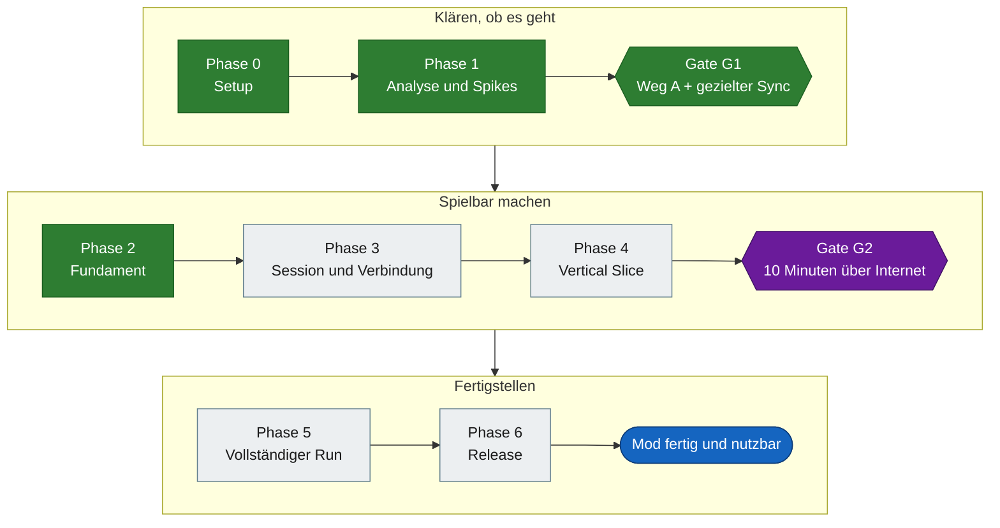
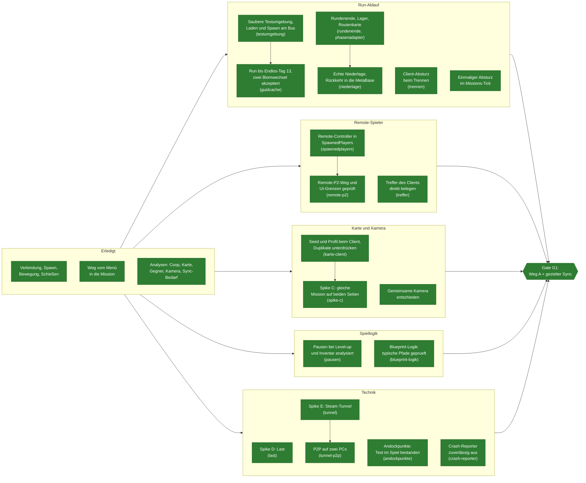
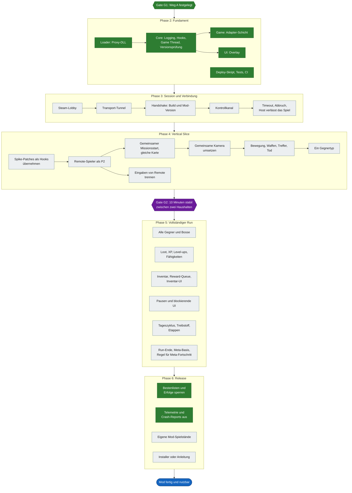
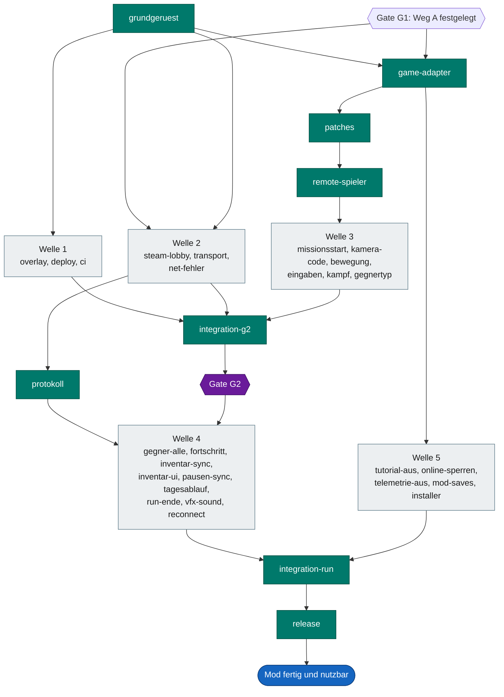

# Roadmap als Graph

Diese Seite zeigt, was bis zur fertigen und nutzbaren Mod noch offen ist. Führend bleibt [TODO.md](../TODO.md), hier steht nur die Übersicht.

**Fertig und nutzbar** heißt: Zwei Spieler finden sich über Steam, spielen einen kompletten Run online, und die Mod lässt sich installieren, ohne Spielstände oder Bestenlisten zu berühren. Dafür müssen alle Punkte mit P0 und P1 erledigt sein. P2 und [Optionale Optimierungen](../TODO.md#optionale-optimierungen) kommen danach.

Den Fortschritt je Phase zeigt das [README](../README.md#fortschritt).

## Stand und nächste Schritte

Projektanalyse vom 02.11.2026 auf Commit `6b9e651`.

**Was läuft.** Zwei Instanzen spielen im Spike dieselbe Mission, mit Bewegung und Schüssen beider Seiten. Der Client erreicht Tag 2. Die Analysen zu Coop, Karte, Gegnern, Kamera und Sync-Bedarf sind abgeschlossen. Unter `src/` steht das Grundgerüst aus Solution, `Loader`, `Core` und Modul-Einstiegen.

**Was fehlt.** Es gibt keinen kompletten Run. Mod-Code mit Spielbezug gibt es erst als Adapter-Schicht, die nur liest. Der Sync-Entwurf ist weder umgesetzt noch im Netz getestet. Getestet wurde bisher nur über Loopback auf einem PC, nicht über echtes Internet.

**Geprüft bei dieser Analyse.** Installiert ist weiterhin Build `26187885`. Seit dem letzten erfolgreichen Spike-Build änderte sich nur Dokumentation. Die Unit-Tests und alle relativen Links der Doku sind in Ordnung. Ein Spieltest gehörte nicht dazu.

**Neue Befunde.**

- `remote-p2`, 04.11.2026: Die Phase-1-Frage ist geklärt: aktuelle schwache `ActivePlayers`-Bindungen und native Coop-Aktivierung machen den Remote-Controller beim Host zu P2, ohne zweiten lokalen Spieler. Ein gezielter Guard nimmt nur die lokale P2-Gerätepflicht aus; native Join-Meldung und Aufräumen veralteter Bindungen separat geprüft. Bewegung und Controller-Tausch funktionieren in der Probe, die lokale UI-Kontrollübergabe im Lager dagegen nicht über das Netz. `remote-spieler`, `eingaben` und Inventar-/UI-Sync bleiben Umsetzungsaufgaben. [Nachweise, Gegenprobe und Grenzen](../research/spikes/a-connect/RemoteP2.md).
- `phasenadapter`, 04.11.2026: Der Client sieht bei jedem Rundenende dieselbe Phase wie der Host (Rundenübersicht, Lager, Routenkarte) und ist dort gesperrt. Der Host erkennt die Phasen an den Panels über `ProcessEvent`, der Client sperrt mit `DisableInput` und zeigt ein Banner. Im Spiel an der ersten Route und an drei Rundenenden geprüft. Transport ist noch eine Datei auf einem PC, über das Netz trägt ihn `transport`/`protokoll`. [Details](../research/spikes/a-connect/RoundPhaseRuntime.md).
- `gate-g1`, 04.11.2026: Nutzer bestätigt verbindlich Weg A als Grundlage, ergänzt um gezielten eigenen Sync für XP, Währungen, Rewards, Pausen und UI. Architekturentscheidung und G1 abgeschlossen; Weg B bleibt nur Rückfalloption bei neuen Gegenbefunden. Transport/Protokoll und konkrete Umsetzung bleiben eigene Aufgaben, Gate G2 und Internet-Abnahme sind dadurch nicht erledigt. [Entscheidung](ARCHITECTURE.md#entscheidungen).
- `game-adapter`, 04.11.2026: Phase 2 ist abgeschlossen. `src/Game` hängt einen Takt an die Fensterprozedur des `UnrealWindow` und ruft darüber `Core::GameThread().Drain()` und die Adapter-Ticks auf dem Game Thread. Offsets stehen SDK-frei in `Offsets.h` und werden beim Bauen gegen ein lokales Dumper-7-SDK geprüft; die CI baut ohne. Der `WorldAdapter` ist das Muster für alle weiteren Adapter. Host und Client bis Tag 1 ohne Fehler geprüft.
- `guidcache`, 04.11.2026: Blockaden-Clientablauf, Ablauf nachladbarer NetGUID-Pfade während Travel-GC und unvollständige Sneak-Zielwiederverwendung behoben. Test-Godmode für beide Spieler samt Schadens-/Replikationsprobe. Übergangslauf bis Endlos-Tag 13 mit zwei weiteren Biomwechseln; Nutzer akzeptiert den Stand als Abschluss, vorerst keine weiteren Detailtests. Neue konkrete Probleme aus künftigem Testing erhalten ein neues TODO. Testgrenzen (Godmode/`!finish`, kein natürlicher Bosskampf) bleiben dokumentiert, siehe [Abschluss](GAME_ANALYSIS.md#abschluss-und-akzeptierter-testumfang-guidcache).
- `todo-struktur`, 04.11.2026: `TODO.md` neu aufgebaut. Jede Aufgabe steht genau einmal, offen in der Tabelle ihrer Phase mit Prio, Voraussetzungen („Braucht“), Bearbeitungsart und Spielzeit, erledigt alphabetisch unter „Erledigt“. Checkboxen und tasks-Marker entfallen. „Wo kann ich anfangen?“ wird erzeugt, `tasks.py claim` lehnt blockierte und Team-Aufgaben ab. Spike C ist mit `karte-client` und `pcg` erledigt. Gezählt sind jetzt 45 von 84 Aufgaben.
- `testumgebung`, 04.11.2026: Das „seltsame Laden“ ab Tag 2 war eine pausierte Welt: Die Spike-Umleitung übersprang das Abräumen der Zeitanfragen, die Pause aus `FinishMission` blieb stehen. Dazu zerstörte das Freiräumen am Busplatz die Figur des Clients. Beides ist im Spike behoben, Tag 1 bis 4 laden sauber mit je 2 PlayerStates am Bus. Der PlayerState-Verlust an Tag 4 tritt damit nicht mehr auf, der Client-Absturz an Tag 5 bleibt für `guidcache`. Prüfskript `check_round.py` und fester Routenlauf `Run-Route.ps1` liegen im Repo.
- `aufgabenstatus`, 04.11.2026: Abschlussstatus kommt verbindlich aus den Checkboxen in `TODO.md`; erledigte Pakete stehen getrennt vom offenen Einstiegskatalog. README-Zahlen und Balken werden mit `tools/task_status.py update` daraus aktualisiert und in CI geprüft. Reservierungsbranches und Teil-PRs ersetzen keine Abnahme; fehlendes `gh` macht erledigte Pakete nicht wieder frei. Keine neuen Spielabnahmen und keine Änderung an den gezählten Abschlüssen (45/84).

- `overlay`, 03.11.2026: Phase-2-UI als F8-Toolfenster mit Status-/Debug-Anzeige und vorbereiteten Lobby-Aktionen umgesetzt. Sichtbare Host-/Client-Abnahme auf Build `26187885` bei 100 % und 150 % Skalierung bestanden (F8, Tab, Schließen, Fokuswechsel, Verschieben, Minimieren/Wiederherstellen). Ohne Phase-3-Backend bleiben Lobby-Aktionen gesperrt. [Abnahme und Grenzen](../src/UI/README.md#sichtbare-spielabnahme-03112026).
- `kamera-entscheidung`, 03.11.2026: Gemeinsame Kamera (Option A) für den ersten spielbaren Stand festgelegt, mit ursprünglichem Zoom und Bewegungsbegrenzung. Umsetzung bleibt `kamera-code`; getrennte Kameras sind nur ein optionales Zukunfts-TODO.
- `tageswechsel`, 03.11.2026: Der dritte Client-Absturz an Tag 4 ist behoben, die AttributeSet-Suche prüft jetzt selbst. Ursache der Abstürze ist aber, dass dem Client ab Tag 4 die PlayerStates fehlen: In seinem NetGUID-Cache fehlen die Einträge der PlayerState-Klasse, an Tag 5 stürzt er ab. Wo sie verloren gehen, ist offen. Zuerst `testumgebung`, dann `guidcache`.
- `tag3`, 03.11.2026: Der Host-Absturz bei der Reise auf Tag 3 kam von einem Kartengenerator-Lambda mit rohem Zeiger auf die alte Karte. Mit diesem Fix, dem Timer-Cleanup des Achievement-Detektors und der Exp-Aggregation kam der Run zweimal über die echte Route auf Tag 3, mit gleichen Inventaren. Der Client stürzt an Tag 4 noch ab, Folgeaufgabe `tageswechsel`.
- `spawnedplayers`, 03.11.2026: Hash-/SparseArray-korrekte Bereinigung und native TSet-Einfügung umgesetzt, synthetische Tests und begrenzte Traveltests bestanden. Den Registrierungshook auf der echten Route abzunehmen ist Folgeaufgabe `spawnedplayers-lauf`.
- `spawnedplayers-lauf`, 03.11.2026: Der Hook greift bei Beitritt, erneutem Beitritt und Missionswechsel. Nach jedem Missionswechsel ersetzt der Host aber den Controller des Clients ohne Registrierung, bis zu einer Sekunde lang steht dann ein alter Controller in der Menge. Folgeaufgabe `controller-tausch`.
- `controller-tausch`, 04.11.2026: Der Host meldet den Tausch über das Blueprint-Ereignis `K2_OnSwapPlayerControllers` des GameModes. Der Spike tauscht dort den Eintrag sofort aus. Über zwei Missionswechsel musste der Sekunden-Abgleich nichts mehr nachtragen.
- `build-id`, 03.11.2026: Geprüfte Entwicklungskopie außerhalb von Steam, keine Links zur automatisch aktualisierten Installation. Host/Client samt Mod aus Build `26187885` verbunden getestet. [Einrichtung](SETUP.md#gleiche-build-id-im-team), neue Build-Unterstützung bleibt eine eigene Aufgabe.
- `rundenende` zeigt: Das Spiel überträgt die Endphase nicht, und nachspielen lässt sie sich beim Client nicht. Nötig ist eine eigene Host-Nachricht, also ein Kontrollkanal, den es auch im Spike noch nicht gibt.
- `rundenende`, 03.11.2026: Codec, Empfänger und lokaler Laufzeitadapter ohne Spiel getestet. Automatische Hostquellen, sichtbarer Lauf und vollständige Eingabesperre fehlen, Folgeaufgabe `phasenadapter`.
- In `TODO.md` fehlten fünf Aufgaben, die jetzt eingetragen sind: Kontrollkanal, Übernahme der Spike-Patches, Umsetzung der Kamera, Pausen über den Kontrollkanal und der einmalige Absturz im Missions-Tick.

**Reihenfolge.**

1. `guidcache` ist mit akzeptiertem Run-/Endlos-Stand abgeschlossen. Keine weiteren Detailtests einplanen; bei einem neuen konkreten Fehler ein neues TODO anlegen.
2. `remote-p2` ist als Analyse abgeschlossen, ebenso `karte-client`. Als Grundlage für `remote-spieler` die dokumentierten Patches und die Grenze der lokalen Geräte-/UI-Logik übernehmen; die Produktionsintegration nicht mit diesem Spike-Abschluss verwechseln.
3. Parallel ohne Spielzeit: `grundgeruest`, `tunnel` und `crash-reporter`.
4. Gate G1 ist entschieden: Weg A mit gezielten Sync-Ergänzungen umsetzen. `steam-lobby`, `transport` und `patches` sind durch G1 nicht mehr blockiert; ihre übrigen Voraussetzungen gelten weiter.

## Gesamtweg

## Weg bis Gate G1

Hier liegt die aktuelle Arbeit. Die Kennungen in Klammern stehen in [TODO.md](../TODO.md), was gerade frei ist, zeigt [Wo kann ich anfangen?](../TODO.md#wo-kann-ich-anfangen).

## Von Gate G1 bis zur fertigen Mod

## Zentral und parallel

Türkis ist zentrale Arbeit, die nacheinander läuft. Grau sind Pakete, die daneben parallel laufen. Die Kennungen und ihre genauen Abhängigkeiten (Spalte „Braucht“) stehen in [TODO.md](../TODO.md).

## Legende

| Farbe | Bedeutung |
|---|---|
| Grün | Erledigt |
| Gelb | In Arbeit oder teilweise erledigt |
| Grau | Offen |
| Rot | Größtes Hindernis |
| Orange | Wartet auf eine Entscheidung des Teams |
| Lila | Gate |
| Blau | Ziel |
| Türkis | Zentrale Arbeit |

Die Pfeile innerhalb einer Phase zeigen eine sinnvolle Reihenfolge. Sie sind eine Planung, keine belegten technischen Abhängigkeiten.

Gate G1 ist mit Weg A und gezielten Sync-Ergänzungen abgeschlossen. Ein Wechsel zu Weg B oder eine Verkleinerung wäre nur bei neuen konkreten Gegenbefunden erneut vom Team zu entscheiden; derzeit ist dafür keine zusätzliche Aufgabe geplant.

## Pflege

Wer eine Aufgabe abschließt, ändert hier die Farbe des Knotens. Die Zählung im [README](../README.md#fortschritt) erzeugt `py tools/task_status.py update`. Aufgaben ohne eigenen Knoten gehören zum thematisch passenden Knoten. Die Wellen fassen Aufgaben mit gleichen Voraussetzungen zusammen, verbindlich ist die Spalte „Braucht“ in `TODO.md`.
