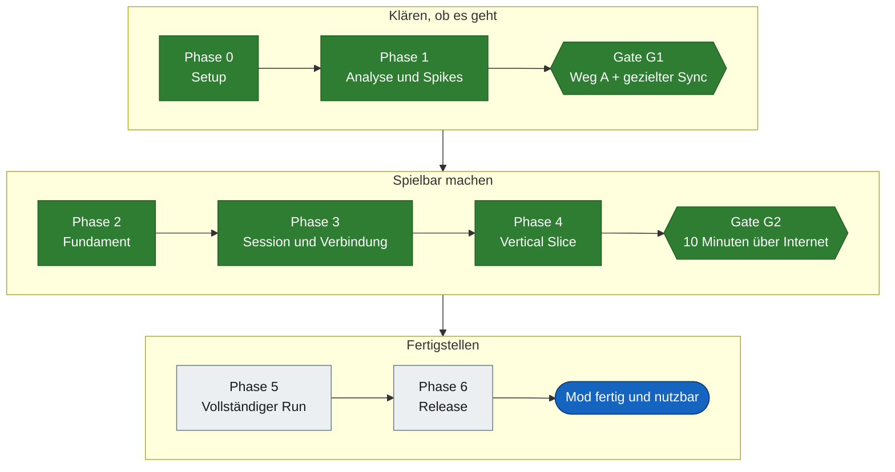

# Roadmap

Übersicht bis zur fertigen und nutzbaren Mod, nur auf Ebene der Phasen. Führend ist [TODO.md](../TODO.md).
Die frühere, ausführliche Roadmap mit Befunden steht im [Archiv](archive/ROADMAP.md).

**Fertig und nutzbar** heißt: Zwei Spieler finden sich über Steam, spielen einen kompletten Run online, und die Mod lässt sich installieren, ohne Spielstände oder Bestenlisten zu berühren.
Dafür müssen alle Aufgaben mit P0 und P1 erledigt sein.

## Gesamtweg

## Stand

- Der Run zu zweit über das Internet ist spielbar: `integration-run` ist erledigt, der Stand erscheint als Release 1.0.
- Offene Fehler aus dem Live-Test vom 24.11.2026 (P1, Phase 5): `airdrop-auswahl-absturz`, `lobby-rauswurf`, `wiedereintritt-karte`, `spawn-nach-kartenaufbau` (nur bei bestätigter Theorie). Je eine Fallakte unter [docs/faelle/](faelle/).
- Bestätigungstests in Phase 5: `lager-edit-ablehnung`, `opt-metabase-inventar`, `labyrinth-event-client`.
- Danach `release` (Phase 6). Optionale Aufgaben warten, bis Phase 0 bis 5 erledigt sind.
- Den Fortschritt je Phase zeigt das [README](../README.md#progress), die aktuelle Liste `py tools/tasks.py list --short`.

## Legende

| Farbe | Bedeutung |
|---|---|
| Grün | Erledigt |
| Gelb | In Arbeit oder teilweise erledigt |
| Grau | Offen |
| Rot | Größtes Hindernis |
| Orange | Wartet auf eine Entscheidung des Teams |
| Lila | Gate |
| Blau | Ziel |
| Türkis | Zentrale Arbeit |

Die Pfeile innerhalb einer Phase zeigen eine sinnvolle Reihenfolge. Sie sind eine Planung, keine belegten technischen Abhängigkeiten.

Gate G1 ist mit Weg A und gezielten Sync-Ergänzungen abgeschlossen. Ein Wechsel zu Weg B oder eine Verkleinerung wäre nur bei neuen konkreten Gegenbefunden erneut vom Team zu entscheiden; derzeit ist dafür keine zusätzliche Aufgabe geplant.

## Pflege

Die Phasenknoten werden umgefärbt, wenn eine Phase erledigt ist. Der Abschnitt „Stand“ wird ersetzt, nicht ergänzt.
Einzelne Aufgaben und Befunde stehen nicht hier, sondern in [TODO.md](../TODO.md), [docs/ERLEDIGT.md](ERLEDIGT.md) und den Fallakten.
