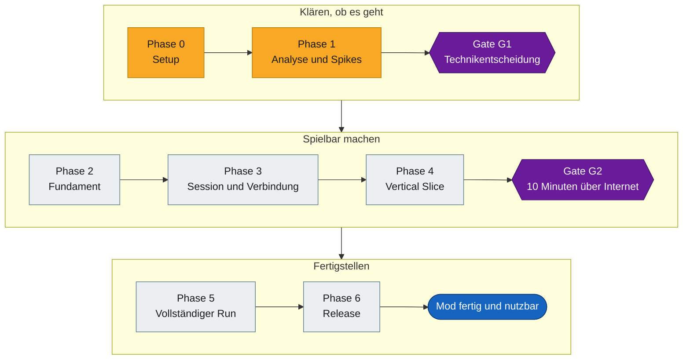
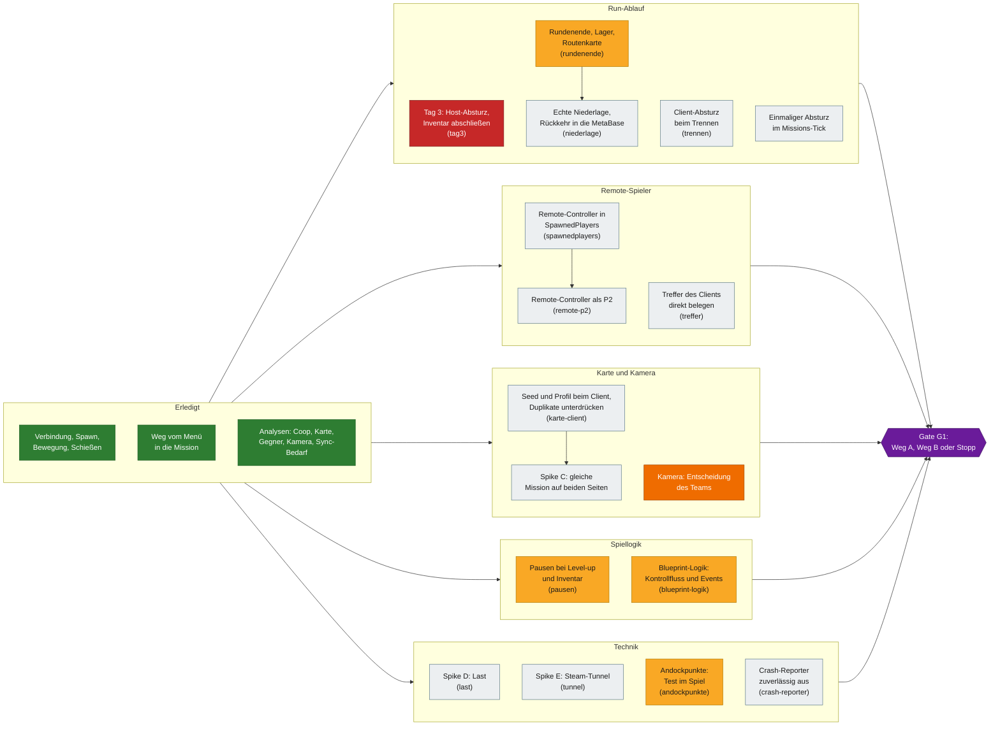
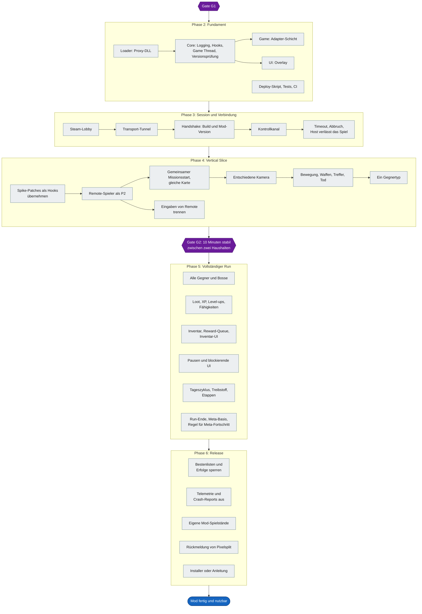
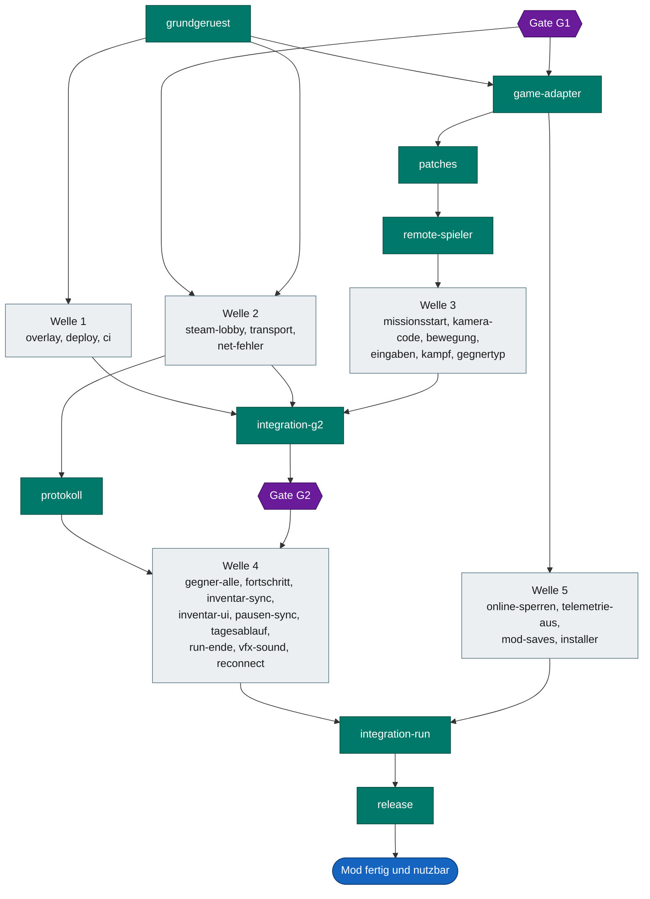

# Roadmap als Graph

Diese Seite zeigt, was bis zur fertigen und nutzbaren Mod noch offen ist. Führend bleibt [TODO.md](../TODO.md), hier steht nur die Übersicht.

**Fertig und nutzbar** heißt: Zwei Spieler finden sich über Steam, spielen einen kompletten Run online, und die Mod lässt sich installieren, ohne Spielstände oder Bestenlisten zu berühren. Dafür müssen alle Punkte mit P0 und P1 erledigt sein. P2 und [Optionale Optimierungen](../TODO.md#optionale-optimierungen) kommen danach.

Den Fortschritt je Phase zeigt das [README](../README.md#fortschritt).

## Stand und nächste Schritte

Projektanalyse vom 02.11.2026 auf Commit `6b9e651`.

**Was läuft.** Zwei Instanzen spielen im Spike dieselbe Mission, mit Bewegung und Schüssen beider Seiten. Der Client erreicht Tag 2. Die Analysen zu Coop, Karte, Gegnern, Kamera und Sync-Bedarf sind abgeschlossen.

**Was fehlt.** Es gibt keinen kompletten Run, keine Mod unter `src/` und keine CI. Der Sync-Entwurf ist weder umgesetzt noch im Netz getestet. Getestet wurde bisher nur über Loopback auf einem PC, nicht über echtes Internet.

**Geprüft bei dieser Analyse.** Installiert ist weiterhin Build `26187885`. Seit dem letzten erfolgreichen Spike-Build änderte sich nur Dokumentation. Die Unit-Tests und alle relativen Links der Doku sind in Ordnung. Ein Spieltest gehörte nicht dazu.

**Neue Befunde.**

- `rundenende` zeigt: Das Spiel überträgt die Endphase nicht, und nachspielen lässt sie sich beim Client nicht. Nötig ist eine eigene Host-Nachricht, also ein Kontrollkanal, den es auch im Spike noch nicht gibt.
- Die Ergebnisse von `rundenende` sind eingereicht, die Aufgabe bleibt offen: Die Phasenübertragung selbst fehlt, siehe [Untersuchung](GAME_ANALYSIS.md#rundenende-befund-und-offene-phasenübertragung-rundenende).
- In `TODO.md` fehlten fünf Aufgaben, die jetzt eingetragen sind: Kontrollkanal, Übernahme der Spike-Patches, Umsetzung der Kamera, Pausen über den Kontrollkanal und der einmalige Absturz im Missions-Tick.

**Reihenfolge.**

1. `tag3` lösen. Ohne diesen Schritt ist kein Run über Tag 2 hinaus möglich.
2. `spawnedplayers`, danach `remote-p2`, und `karte-client`. Diese Aufgaben brauchen Spielzeit, und pro PC läuft nur eine Sitzung.
3. Parallel ohne Spielzeit: `grundgeruest`, `tunnel` und `crash-reporter`.
4. `last` messen und an Gate G1 entscheiden.

**Wartet auf das Team.**

- Kamera entscheiden
- Aufteilung auf die Arbeitsbereiche festlegen
- Update-Regel festlegen und klären, ob alle auf derselben Build-ID bleiben können. Das Spiel wird aktiv gepatcht, und jedes Update macht die Offsets ungültig
- Pixelsplit über das Projekt informieren
- Dumper-7-Fix dem Dumper-7-Projekt vorschlagen

## Gesamtweg

## Weg bis Gate G1

Hier liegt die aktuelle Arbeit. Die Kennungen in Klammern stehen in [Wo kann ich anfangen?](../TODO.md#wo-kann-ich-anfangen), reserviert wird wie dort beschrieben.

## Von Gate G1 bis zur fertigen Mod

## Zentral und parallel

Türkis ist zentrale Arbeit, die nacheinander läuft. Grau sind Pakete, die daneben parallel laufen. Die Kennungen stehen in [Spätere Arbeitspakete](../TODO.md#spätere-arbeitspakete) und [Zentrale Arbeit](../TODO.md#zentrale-arbeit).

## Legende

| Farbe | Bedeutung |
|---|---|
| Grün | Erledigt |
| Gelb | In Arbeit oder teilweise erledigt |
| Grau | Offen |
| Rot | Größtes Hindernis |
| Orange | Wartet auf eine Entscheidung des Teams |
| Lila | Gate |
| Blau | Ziel |
| Türkis | Zentrale Arbeit |

Die Pfeile innerhalb einer Phase zeigen eine sinnvolle Reihenfolge. Sie sind eine Planung, keine belegten technischen Abhängigkeiten.

Unabhängig von den Gates kann das [Grundgerüst](../TODO.md#phase-2--fundament) (`grundgeruest`) schon parallel entstehen. An G1 kann der Weg noch kippen: Bei Weg B wächst Phase 5 deutlich, bei einem Stopp entfallen die Phasen danach.

## Pflege

Wer eine Aufgabe abschließt, ändert hier die Farbe des Knotens und im [README](../README.md#fortschritt) die Zählung der Phase. Offene Teilpunkte aus `TODO.md`, die keinen eigenen Knoten haben, gehören zum thematisch passenden Knoten.
